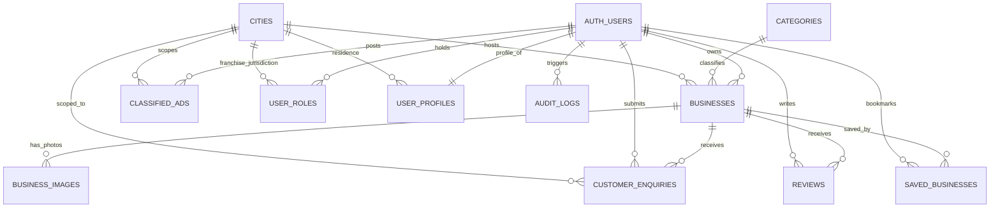

# KAARYAN LABS — DATABASE SCHEMA & RELATIONAL MODEL
## Multi-City Local Business Platform (PostgreSQL / Supabase)

**Platform Coverage:** Chittoor (AP-03), Vellore (TN-23), Bengaluru (KA-01)
**Database Engine:** PostgreSQL 15+ (with `uuid-ossp` and `pgcrypto` extensions)
**Security Framework:** Row Level Security (RLS) on all tables with server-side anti-tampering triggers.

---

## 1. Entity-Relationship Diagram



---

## 2. Table Specifications

### 2.1. `cities`
Maintains official city configurations, district codes, state metadata, and domain mappings.

| Column | Type | Constraints | Description |
| :--- | :--- | :--- | :--- |
| `id` | `TEXT` | `PRIMARY KEY` | Stable city identifier (`chittoor`, `vellore`, `bengaluru`) |
| `slug` | `TEXT` | `UNIQUE NOT NULL` | URL-safe slug |
| `name` | `TEXT` | `NOT NULL` | Display name (e.g. `Chittoor`) |
| `state` | `TEXT` | `NOT NULL` | State name (e.g. `Andhra Pradesh`) |
| `brand_name` | `TEXT` | `NOT NULL` | Platform brand (e.g. `ChittoorAds`) |
| `domain` | `TEXT` | `NOT NULL` | Production domain (e.g. `chittoorads.com`) |
| `code` | `TEXT` | `NOT NULL` | Official district transport code (`AP-03`, `TN-23`, `KA-01`) |
| `status` | `TEXT` | `CHECK (status IN ('active', 'coming_soon', 'inactive'))` | Launch readiness status |
| `created_at` | `TIMESTAMPTZ` | `DEFAULT timezone('utc', now())` | Record creation timestamp |
| `updated_at` | `TIMESTAMPTZ` | `DEFAULT timezone('utc', now())` | Last modified timestamp |

---

### 2.2. `user_profiles`
Public profile information linked 1:1 with Supabase Auth users. Plaintext passwords are never stored.

| Column | Type | Constraints | Description |
| :--- | :--- | :--- | :--- |
| `id` | `UUID` | `PRIMARY KEY, REFERENCES auth.users(id) ON DELETE CASCADE` | Linked auth user UID |
| `display_name` | `TEXT` | `NOT NULL` | Merchant or customer display name |
| `phone` | `TEXT` | Nullable | Verified phone or WhatsApp contact |
| `email` | `TEXT` | `NOT NULL` | Primary email address |
| `city_id` | `TEXT` | `REFERENCES public.cities(id) ON DELETE SET NULL` | Primary affiliated city |
| `account_status`| `TEXT` | `CHECK (account_status IN ('active', 'suspended', 'pending_verification'))` | Account standing |
| `created_at` | `TIMESTAMPTZ` | `DEFAULT timezone('utc', now())` | Registration timestamp |
| `updated_at` | `TIMESTAMPTZ` | `DEFAULT timezone('utc', now())` | Last update timestamp |

---

### 2.3. `user_roles`
Server-controlled authorization records enforcing multi-city permissions.

| Column | Type | Constraints | Description |
| :--- | :--- | :--- | :--- |
| `id` | `UUID` | `PRIMARY KEY DEFAULT gen_random_uuid()` | Role record ID |
| `user_id` | `UUID` | `NOT NULL REFERENCES auth.users(id) ON DELETE CASCADE` | Assigned user UID |
| `city_id` | `TEXT` | `REFERENCES public.cities(id) ON DELETE CASCADE` | City boundary (`NULL` = global) |
| `role` | `TEXT` | `CHECK (role IN ('customer', 'business_owner', 'data_entry_staff', 'city_franchise', 'super_admin'))` | Assigned security role |
| `assigned_by` | `UUID` | `REFERENCES auth.users(id)` | Administrator UID who granted role |
| `created_at` | `TIMESTAMPTZ` | `DEFAULT timezone('utc', now())` | Assignment timestamp |

*Unique constraint:* `(user_id, role, city_id)` prevents duplicate role assignments.

---

### 2.4. `categories`
Standardized multi-lingual business categories across all cities.

| Column | Type | Constraints | Description |
| :--- | :--- | :--- | :--- |
| `id` | `TEXT` | `PRIMARY KEY` | Category slug (e.g. `restaurants`, `hotels-lodges`) |
| `name` | `TEXT` | `NOT NULL` | English category name |
| `name_te` | `TEXT` | `NOT NULL` | Telugu localized name |
| `name_ta` | `TEXT` | Nullable | Tamil localized name |
| `name_kn` | `TEXT` | Nullable | Kannada localized name |
| `icon` | `TEXT` | `NOT NULL` | Lucide icon identifier |
| `description` | `TEXT` | Nullable | Category summary description |
| `sort_order` | `INT` | `DEFAULT 0` | Display hierarchy priority |
| `created_at` | `TIMESTAMPTZ` | `DEFAULT timezone('utc', now())` | Creation timestamp |

---

### 2.5. `businesses`
Central business directory entities supporting moderation lifecycle, verified locality mapping, and anti-tampering guards.

| Column | Type | Constraints | Description |
| :--- | :--- | :--- | :--- |
| `id` | `UUID` | `PRIMARY KEY DEFAULT gen_random_uuid()` | Business unique ID |
| `legacy_id` | `TEXT` | `UNIQUE` | Stable ID mapping (e.g. `c-001`, `v-001`, `b-001`) |
| `city_id` | `TEXT` | `NOT NULL REFERENCES public.cities(id)` | Territorial city association |
| `owner_id` | `UUID` | `REFERENCES auth.users(id) ON DELETE SET NULL` | Verified business owner UID |
| `category_id` | `TEXT` | `NOT NULL REFERENCES public.categories(id)` | Primary business category |
| `name` | `TEXT` | `NOT NULL` | Business title / company name |
| `description` | `TEXT` | `NOT NULL` | Detailed business description |
| `phone` | `TEXT` | `NOT NULL` | Primary voice telephone number |
| `whatsapp` | `TEXT` | Nullable | Direct WhatsApp messaging number |
| `email` | `TEXT` | Nullable | Official merchant email |
| `address` | `TEXT` | `NOT NULL` | Physical storefront address |
| `locality` | `TEXT` | `NOT NULL` | Area slug matching city locality config |
| `latitude` | `DOUBLE PRECISION` | Nullable | GPS latitude coordinate |
| `longitude` | `DOUBLE PRECISION` | Nullable | GPS longitude coordinate |
| `status` | `TEXT` | `CHECK (status IN ('draft', 'pending', 'active', 'rejected', 'suspended'))` | Approval lifecycle status |
| `is_verified` | `BOOLEAN` | `DEFAULT false` | Verified business shield |
| `is_featured` | `BOOLEAN` | `DEFAULT false` | Premium promotional highlight |
| `rating` | `NUMERIC(2,1)` | `CHECK (rating >= 0 AND rating <= 5)` | Composite rating (0 = unrated) |
| `reviews_count`| `INT` | `CHECK (reviews_count >= 0)` | Total number of approved reviews |
| `views_count` | `INT` | `CHECK (views_count >= 0)` | Public view impression count |
| `price_range` | `TEXT` | `DEFAULT 'Best Market Rate'` | Price indicator |
| `timings` | `TEXT` | `DEFAULT 'Daily: 9:00 AM - 8:00 PM'` | Operating hours |
| `services` | `TEXT[]` | `DEFAULT '{}'` | Array of service offerings / tags |
| `badge` | `TEXT` | Nullable | Visual status pill |
| `created_at` | `TIMESTAMPTZ` | `DEFAULT timezone('utc', now())` | Submission timestamp |
| `updated_at` | `TIMESTAMPTZ` | `DEFAULT timezone('utc', now())` | Last modified timestamp |

---

### 2.6. `business_images`
References to images stored in Supabase Storage (`business-images` bucket).

| Column | Type | Constraints | Description |
| :--- | :--- | :--- | :--- |
| `id` | `UUID` | `PRIMARY KEY DEFAULT gen_random_uuid()` | Image record ID |
| `business_id` | `UUID` | `NOT NULL REFERENCES public.businesses(id) ON DELETE CASCADE` | Associated business listing |
| `storage_path` | `TEXT` | `NOT NULL` | Object path inside storage bucket |
| `image_url` | `TEXT` | Nullable | Public CDN URL |
| `is_cover` | `BOOLEAN` | `DEFAULT false` | Whether image is the primary cover |
| `sort_order` | `INT` | `DEFAULT 0` | Display gallery order |
| `created_at` | `TIMESTAMPTZ` | `DEFAULT timezone('utc', now())` | Upload timestamp |

---

### 2.7. `customer_enquiries`
Private business inquiries and customer leads.

| Column | Type | Constraints | Description |
| :--- | :--- | :--- | :--- |
| `id` | `UUID` | `PRIMARY KEY DEFAULT gen_random_uuid()` | Enquiry record ID |
| `business_id` | `UUID` | `NOT NULL REFERENCES public.businesses(id) ON DELETE CASCADE` | Target business listing |
| `city_id` | `TEXT` | `NOT NULL REFERENCES public.cities(id)` | City territory |
| `customer_id` | `UUID` | `REFERENCES auth.users(id) ON DELETE SET NULL` | Authenticated customer UID |
| `customer_name`| `TEXT` | `NOT NULL` | Contact name (min 2 characters) |
| `customer_phone`| `TEXT` | `NOT NULL` | 10–15 digit phone number |
| `customer_email`| `TEXT` | Nullable | Customer email |
| `message` | `TEXT` | `NOT NULL` | Requirement inquiry (min 5 characters) |
| `status` | `TEXT` | `CHECK (status IN ('pending', 'read', 'replied', 'archived'))` | Processing status |
| `created_at` | `TIMESTAMPTZ` | `DEFAULT timezone('utc', now())` | Lead creation timestamp |

---

### 2.8. `classified_ads`
Community classified listings partitioned by city.

| Column | Type | Constraints | Description |
| :--- | :--- | :--- | :--- |
| `id` | `UUID` | `PRIMARY KEY DEFAULT gen_random_uuid()` | Classified ad ID |
| `legacy_id` | `TEXT` | `UNIQUE` | Stable ID mapping |
| `city_id` | `TEXT` | `NOT NULL REFERENCES public.cities(id)` | City territory |
| `owner_id` | `UUID` | `REFERENCES auth.users(id) ON DELETE SET NULL` | Posting user UID |
| `title` | `TEXT` | `NOT NULL` | Ad title |
| `category` | `TEXT` | `NOT NULL` | Classified category |
| `price` | `TEXT` | `NOT NULL` | Asking price |
| `condition` | `TEXT` | `NOT NULL` | Item condition (e.g. `Used - Like New`) |
| `locality` | `TEXT` | `NOT NULL` | Location within city |
| `phone` | `TEXT` | `NOT NULL` | Contact phone number |
| `whatsapp` | `TEXT` | Nullable | WhatsApp contact number |
| `image_url` | `TEXT` | Nullable | Item photograph URL |
| `description` | `TEXT` | `NOT NULL` | Full item description |
| `status` | `TEXT` | `CHECK (status IN ('active', 'pending', 'expired'))` | Ad visibility status |
| `created_at` | `TIMESTAMPTZ` | `DEFAULT timezone('utc', now())` | Creation timestamp |

---

### 2.9. `reviews` & `saved_businesses`
Customer feedback and personal bookmarks.

- **`reviews`**: Holds user ratings (1 to 5), sub-ratings (quality, value, cleanliness), text comments, and approval state (`approved` / `pending`).
- **`saved_businesses`**: Composite primary key `(user_id, business_id)` allowing authenticated users to bookmark listings.

---

### 2.10. `audit_logs`
Immutable audit records tracking privileged actions.

| Column | Type | Constraints | Description |
| :--- | :--- | :--- | :--- |
| `id` | `UUID` | `PRIMARY KEY DEFAULT gen_random_uuid()` | Log entry ID |
| `user_id` | `UUID` | `REFERENCES auth.users(id) ON DELETE SET NULL` | Actor UID |
| `action` | `TEXT` | `NOT NULL` | Action code (`LISTING_APPROVAL`, etc.) |
| `entity_type` | `TEXT` | `NOT NULL` | Target table / entity |
| `entity_id` | `TEXT` | `NOT NULL` | Target record ID |
| `city_id` | `TEXT` | `REFERENCES public.cities(id)` | Associated city jurisdiction |
| `details` | `JSONB` | `DEFAULT '{}'::jsonb` | Structured before/after diff |
| `ip_address` | `TEXT` | Nullable | Client IP address |
| `created_at` | `TIMESTAMPTZ` | `DEFAULT timezone('utc', now())` | Event timestamp |

---

## 3. Database Indexes

```sql
-- High-performance query indexes
CREATE INDEX idx_businesses_city_status ON public.businesses(city_id, status);
CREATE INDEX idx_businesses_owner ON public.businesses(owner_id);
CREATE INDEX idx_businesses_category ON public.businesses(category_id);
CREATE INDEX idx_businesses_locality ON public.businesses(locality);
CREATE INDEX idx_enquiries_business ON public.customer_enquiries(business_id);
CREATE INDEX idx_enquiries_city ON public.customer_enquiries(city_id);
CREATE INDEX idx_enquiries_customer ON public.customer_enquiries(customer_id);
CREATE INDEX idx_classifieds_city_status ON public.classified_ads(city_id, status);
CREATE INDEX idx_reviews_business_status ON public.reviews(business_id, status);
CREATE INDEX idx_audit_logs_entity ON public.audit_logs(entity_type, entity_id);
```

