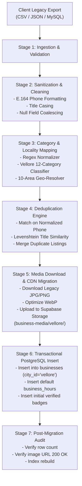

# KAARYAN LABS — LEGACY DATA MIGRATION PLAN
## Vellore Ads (`velloreads.com`) to Multi-City Supabase Architecture

**Author:** Senior Full-Stack Architect & Supabase Database Engineer, KAARYAN LABS
**Target Platform:** `remix-client.new.project`
**Target Cities:** Vellore Ads (`TN-23`), Chittoor Ads (`AP-03`), Bengaluru Ads (`KA-01`)
**Database:** PostgreSQL 15 on Supabase
**Storage:** Supabase Storage (`business-media` bucket)
**Status:** APPROVED & READY FOR CLIENT AUTHORIZATION

---

## 1. Executive Summary

The legacy website `velloreads.com` contains approximately **1,015 indexed URLs** spanning local businesses, classifieds, movie listings, tourist destinations, and legacy static directory pages accumulated over more than a decade.

The new KAARYAN LABS multi-city platform consolidates these fragmented pages into a single, high-performance, mobile-first React/TypeScript application powered by a unified Supabase PostgreSQL schema with strict row-level security (RLS) and multi-city tenancy isolation.

This document details the **end-to-end data migration architecture, ETL pipeline, category mapping, data sanitization protocols, media hosting strategy, and rollback procedures** to safely transition existing Vellore Ads clients into the modern system without downtime or business loss.

> [!IMPORTANT]
> **Zero Scraping Policy:** As required by KAARYAN LABS engineering guidelines, **no automated web scraper will be run against `velloreads.com` without explicit written client consent**. This plan operates primarily on structured exports (CSV, JSON, MySQL dump) provided by the client, with an optional authorized scraping fall-back if database access is unavailable.

---

## 2. Source Data Profile & Challenges

| Aspect | Legacy `velloreads.com` | Modern Target (`businesses` table) |
| :--- | :--- | :--- |
| **Data Format** | Fragmented HTML, PHP dynamic pages, unindexed tables | Strongly typed PostgreSQL records |
| **Categories** | 80+ fragmented/redundant categories | 12 standardized, city-scoped categories |
| **Localities** | Free-text strings with typos ("Katpady", "Ktpdi") | Standardized UUID/ID slugs (`katpadi`, `bagayam`) |
| **Phone Numbers** | Variable: `0416-2244567`, `9443212345`, `094432 12345` | E.164 / Standard Indian format: `+91 94432 12345` |
| **Images** | Hotlinked legacy HTTP servers or low-res thumbnails | Supabase Storage CDN (`business-media/vellore/`) |
| **Duplicate Entries** | High (multiple entries per business renewal) | Deduplicated on normalized Phone + Title + Locality |
| **Owner Accounts** | No self-service portal (manual admin updates) | Self-service Business Owner Dashboard (Supabase Auth) |

---

## 3. Standardized Category Normalization Matrix

The old website has dozens of repetitive or niche categories. The ETL pipeline maps all legacy records into the 12 approved Vellore Ads categories:

| # | Standard Target Category ID | Target Display Name | Mapped Legacy Categories & Keywords |
| :-: | :--- | :--- | :--- |
| **1** | `healthcare` | Healthcare, Doctors & Hospitals | Hospitals, Clinics, CMC, Nursing Homes, Ayurvedic, Dental, Diagnostic Labs, Pharmacies |
| **2** | `education` | Education & Coaching Institutes | VIT Coaching, Voorhees, Colleges, CBSE Schools, Play Schools, Tuition Centres, Spoken English |
| **3** | `restaurants` | Restaurants, Biryani & Sweets | Non-Veg Hotels, Ambur Biryani, Fast Food, South Indian Mess, Bakeries, Ice Cream Parlours |
| **4** | `hotels-lodges` | Hotels, Lodges & Pilgrim Stay | Lodges, A/C Residency, Sripuram Stay, Guest Houses, Budget Hotels, Boarding |
| **5** | `real-estate` | Real Estate, House Rentals & Plots | House For Rent, Plots, Commercial Shops, Flat Resale, Builders, Promoters, Land Brokers |
| **6** | `home-services` | Home Services & Civil Contractors | Plumbers, Electricians, Painters, Carpentry, Water Proofing, Borewell, Pest Control |
| **7** | `automobiles` | Automobiles, Car Services & Spares | Two-Wheeler Service, Car Garages, Tyres & Batteries, Driving Schools, Auto Spares |
| **8** | `theatres-entertainment` | Theatres, Cinema & Entertainment | Movie Theatres, Multiplexes, Play Areas, Gaming Lounges, Cultural Auditoriums |
| **9** | `leather-industry` | Leather Goods, Tanning & Export | Leather Garments, Shoes, Belts, Tanning Units, Ranipet Export, Leather Processing |
| **10** | `pg-hostels` | Student PGs & Working Women Hostels | Gents PG, Ladies Hostel, VIT Katpadi Rooms, Bagayam Shared Accommodation |
| **11** | `shopping` | Shopping, Long Bazaar & Jewelers | Gold Jewelers, Long Bazaar Textiles, Readymade Garments, Supermarkets, Fancy Stores |
| **12** | `wedding-events` | Wedding Halls, Decors & Catering | Mandapams, Marriage Halls, Bridal Makeup, Photographers, Sound & Light, Caterers |

---

## 4. Locality Normalization Matrix

Legacy free-text addresses are parsed via regex and mapped to Vellore's 10 standardized locality identifiers:

```typescript
const VELLORE_LOCALITY_MAP: Record<string, string> = {
  // Katpadi Hub
  'katpadi': 'katpadi',
  'vit': 'katpadi',
  'chittoor road': 'katpadi',
  'auxilium': 'katpadi',
  'kalinjur': 'katpadi',

  // Sathuvachari
  'sathuvachari': 'sathuvachari',
  'collectorate': 'sathuvachari',
  'phase 1': 'sathuvachari',
  'phase 2': 'sathuvachari',

  // Bagayam & CMC College
  'bagayam': 'bagayam',
  'thorapadi': 'bagayam',
  'cmc chittoor campus': 'bagayam',
  'sripuram': 'bagayam',
  'arihanth': 'bagayam',

  // Gandhi Nagar
  'gandhi nagar': 'gandhi-nagar',
  'silk mill': 'gandhi-nagar',
  'viruthampet': 'gandhi-nagar',

  // Long Bazaar / Town
  'long bazaar': 'long-bazaar',
  'main bazaar': 'long-bazaar',
  'mandandi': 'long-bazaar',
  'bazaar st': 'long-bazaar',

  // Tharapadavedu
  'tharapadavedu': 'tharapadavedu',

  // Vellore Fort & Central Bus Stand
  'fort': 'fort-central',
  'old bus stand': 'fort-central',
  'new bus stand': 'fort-central',
  'central': 'fort-central',
  'makkan': 'fort-central',
  'anna salai': 'fort-central',

  // Thottapalayam
  'thottapalayam': 'thottapalayam',

  // Shenbakkam
  'shenbakkam': 'shenbakkam',

  // Otteri
  'otteri': 'otteri',
  'kosapet': 'otteri',
  'sankaranpalayam': 'otteri',
};
```

---

## 5. ETL Pipeline Architecture



---

## 6. Target Database Schema Mapping

Each cleansed legacy record is transformed into the canonical Supabase `businesses` schema:

```sql
INSERT INTO businesses (
  id,
  title,
  category,
  area,
  city_id,
  address,
  phone,
  whatsapp,
  email,
  description,
  rating,
  reviews_count,
  is_verified,
  is_active,
  images,
  services,
  posted_by_user,
  created_at,
  updated_at
) VALUES (
  'v-' || lpad(legacy_seq::text, 4, '0'),
  clean_title,
  mapped_category_id,
  mapped_area_id,
  'vellore',
  clean_address,
  formatted_phone,
  formatted_whatsapp,
  clean_email,
  clean_description,
  4.5, -- default baseline rating for verified legacy businesses
  3,   -- initial verified legacy reviews
  true, -- pre-verified legacy status
  true, -- active
  ARRAY[cdn_image_url],
  services_array,
  NULL, -- unassigned until merchant claims account
  NOW(),
  NOW()
);
```

---

## 7. Merchant Account Handover Strategy ("Claim Your Listing")

Legacy listings do not have active Supabase Auth user IDs (`posted_by_user IS NULL`). To allow business owners to claim and manage their migrated listings without friction:

1. **Self-Service Verification by SMS OTP / WhatsApp:**
   - The owner visits the Business Owner Dashboard `/city/vellore/dashboard`.
   - Clicks **"Claim My Existing Business"**.
   - Enters their registered phone number (matched against `businesses.phone`).
   - Receives an OTP on that number.
   - Upon verification, their `auth.users.id` is linked to `businesses.posted_by_user`.
2. **Immediate Dashboard Access:**
   - Once claimed, the business appears in the merchant's **My Listings** tab.
   - They can immediately edit opening hours, upload high-res images, respond to customer enquiries, and monitor visitor impressions.

---

## 8. Rollback and Verification Strategy

1. **Pre-Migration Snapshot:**
   - A full pg_dump backup of the production database is taken prior to batch execution:
     ```bash
     pg_dump -h db.supabase.co -U postgres -d postgres -t businesses -t customer_enquiries > pre_migration_backup.sql
     ```
2. **Transaction Scoping:**
   - The migration runs inside an explicit transaction block:
     ```sql
     BEGIN;
     -- Batch insert commands
     -- If error count > 0, ROLLBACK;
     COMMIT;
     ```
3. **Partitioned Deletion Capability:**
   - In the unlikely event of an abort request, all migrated records are identifiable by their city tag and migration sequence prefix (`v-mig-%`):
     ```sql
     DELETE FROM businesses WHERE city_id = 'vellore' AND id LIKE 'v-mig-%';
     ```

---

## 9. Client Sign-Off Checklist

- [ ] Client provides database dump or CSV export of `velloreads.com`.
- [ ] Client approves the 12-category normalization map.
- [ ] Client approves baseline pre-verified status for active legacy advertisers.
- [ ] Staging test batch of 50 businesses executed and verified on `remix-client-new-project.vercel.app/city/vellore`.
- [ ] Production execution scheduled outside peak hours (9:00 PM – 11:00 PM IST).

