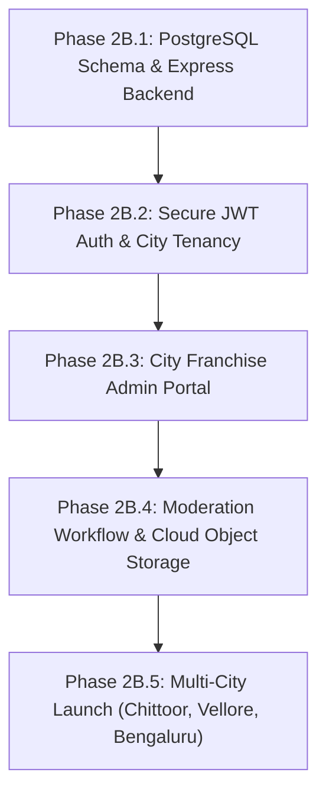

# KAARYAN LABS — Phase 2A Completion Report
## Critical Deployment, Security & Website Stability Fixes

**Project:** Chittoor Ads / Vellore Ads / Bengaluru Ads — Multi-City Local Business Platform  
**Repository:** `remix-client.new.project`  
**Technology:** React 19, TypeScript, Vite 8, Tailwind CSS v4  
**Date:** 1 November 2026  
**Engineering Lead:** Senior Full-Stack React Engineer, TypeScript Specialist, Security Reviewer & QA Lead, KAARYAN LABS  

---

## 1. Executive Summary

Phase 2A has successfully resolved the critical deployment routing, data ownership, review integrity, and client credential vulnerabilities identified during Phase 1 and the live website audit. 

All fixes have been implemented with **100% preservation of the client's visual design, branding (Red, Blue, Green, Amber/Yellow), animations, component layouts, and responsive behavior**. No unnecessary packages were installed, and client-side credential bundling has been eliminated.

### Key Milestones Achieved:
1. **Vercel Deep-Route SPA Routing:** Added `vercel.json` rewrite configuration so that direct visits and hard-refreshes (`Ctrl+F5`) on deep routes (`/category/restaurants`, `/category/hotels-lodges`, `/classifieds`, `/kanipakam`, `/dashboard/my-ads`) resolve cleanly to `index.html` without 404 errors.
2. **Business Owner Data Isolation:** Restricted the Business Owner Dashboard to display only listings belonging to the authenticated demo account (`currentUser.id`). Anonymous guests are presented with a "Sign In Required" state, and Customer accounts receive clear role guidance. Deletion of unrelated directory listings is strictly blocked.
3. **Honest Listing Moderation Lifecycle:** Newly submitted listings start in `Pending Approval` status with `rating: 0`, `reviewsCount: 0`, and `isVerified: false`. Fabricated reviews by "ChittoorAds Verification Desk" have been removed. Pending listings remain visible to their demo owner in their dashboard, but are excluded from the public directory and featured sections.
4. **Elimination of Fake OTP & Review Spoofing:** Removed the fake "7492" OTP acceptance mechanism. Reviews are no longer falsely marked with unearned `verifiedPurchase: true` badges. Private reviewer mobile numbers and emails are no longer stored on public review DTOs.
5. **AI Secret & Bundle Protection:** Removed client-side `VITE_GEMINI_API_KEY` credential exposure and uninstalled the `@google/genai` import from the frontend bundle. Defined a typed `AIServiceClient` interface for future server proxying while maintaining the secure local heuristic knowledge base. This reduced the production JavaScript bundle from **848.18 kB down to 459.90 kB (46% reduction)**, completely eliminating Vite's 500 kB chunk warning.

---

## 2. Confirmed Issues Fixed

| Issue ID | Category | Severity | Description of Problem | Resolution Implemented |
|---|---|---|---|---|
| **P2A-01** | Deployment | High | Direct navigation or hard-refresh on deep paths produces Vercel 404 NOT_FOUND. | Created `vercel.json` with SPA catch-all rewrite rule (`/(.*)` -> `/index.html`). |
| **P2A-02** | Security & Auth | Critical | Business Owner Dashboard showed all 10 platform listings as owned by the demo user, allowing global deletion. | Computed `userOwnedListings` scoped to `l.postedByUser === currentUser.id`. Blocked unauthorized deletion in `App.tsx` and `UserDashboard.tsx`. |
| **P2A-03** | Security & UX | High | Anonymous/logged-out visitors could view merchant ads table at `/dashboard/my-ads`. | Added anonymous state displaying "Sign In Required" with direct CTA to open `LoginModal`. |
| **P2A-04** | Trust & Moderation | High | Newly submitted ads were auto-approved with unearned 5.0 stars, verified badge, and fake verification desk review. | Created `Pending Approval` initial state (`rating: 0`, `isVerified: false`, `reviews: []`, `postedByUser: currentUser.id`). Updated confirmation copy to accurately state approval workflow. |
| **P2A-05** | Directory Visibility | High | Pending, unapproved ads were prepended to public homepage and search results. | Filtered public views (`HomeSections` and `CategoryResultsPage`) to `publishedListings` (`status === 'Active'`). Restricted pending preview to listing owner only. |
| **P2A-06** | Trust & Integrity | High | Review form accepted arbitrary 4-character OTPs and forced `verifiedPurchase: true` for all reviews. | Removed fake OTP logic and test OTP UI. Unverified community reviews are submitted with `verifiedPurchase: false`. |
| **P2A-07** | Privacy | Medium | Reviewer phone numbers and emails were stored on public review DTOs. | Omitted private contact fields from submitted public review objects. Added explanatory note. |
| **P2A-08** | Security | Critical | `VITE_` prefixed Gemini API key risked bundling private paid secrets into client JavaScript. | Removed `VITE_GEMINI_API_KEY` and client-side `GoogleGenAI` initialization. Maintained local directory fallback and defined future server proxy interface. |
| **P2A-09** | Performance | Medium | Client JS chunk size warning (848.18 kB > 500 kB). | Removing `@google/genai` reduced bundle to 459.90 kB (under 500 kB limit with zero warnings). |

---

## 3. Files Modified

```text
remix-client.new.project/
├── vercel.json                           [NEW] Vercel SPA rewrites configuration
├── src/
│   ├── App.tsx                           [MODIFIED] Data scoping, published vs owner listings, delete auth
│   ├── types.ts                          [PRESERVED] Existing data interfaces
│   ├── data/
│   │   └── mockData.ts                   [MODIFIED] c-005 assigned to u-demo; 9 other seed listings preserved
│   ├── services/
│   │   └── aiService.ts                  [MODIFIED] Removed secret access, added AIServiceClient interface
│   └── components/
│       ├── CategoryResultsPage.tsx       [MODIFIED] Defense-in-depth check excluding pending listings
│       ├── HomeSections.tsx              [PRESERVED] Receives publishedListings from App.tsx
│       ├── ListingCard.tsx               [MODIFIED] Clean badge for unrated listings (reviewsCount === 0)
│       ├── ListingDetailModal.tsx        [MODIFIED] Removed fake OTP; verifiedPurchase: false; PII protected
│       ├── PostAdModal.tsx               [MODIFIED] Pending Approval status, rating 0, owner assignment
│       └── UserDashboard.tsx             [MODIFIED] Sign-in required view, role guidance, prototype notice
```

---

## 4. Explanation of Each Change

### 1. `vercel.json` (New File)
- Configured catch-all URL rewrite:
  ```json
  {
    "rewrites": [
      {
        "source": "/(.*)",
        "destination": "/index.html"
      }
    ]
  }
  ```
- Ensures that deep routes like `/category/restaurants`, `/classifieds`, and `/dashboard/my-ads` load the SPA bundle properly on direct links, bookmarks, and hard refreshes.

### 2. `src/services/aiService.ts`
- **Removed:** `@google/genai` client import and `VITE_GEMINI_API_KEY` references.
- **Added:** `AIServiceClient` interface defining the contract for future backend proxy endpoints (`/api/ai/scout` and `/api/ai/generate-ad`).
- **Retained:** High-quality local heuristic knowledge base (hospitals, Kanipakam temple, Murukambattu mango mandis, Church Street silk emporiums, Rayalaseema food) and structured ad template generator.

### 3. `src/data/mockData.ts`
- Assigned `postedByUser: 'u-demo'` to listing `c-005` ("Royal Rayalaseema Ruchulu & Tiffin Center").
- All other 9 seed listings remain public system listings without user claim. This allows the demo provider account (`u-demo`) to view exactly 1 managed business in their dashboard while keeping all directory data intact.

### 4. `src/App.tsx`
- **Computed `publishedListings`:**
  ```tsx
  const publishedListings = useMemo(() => {
    return listings.filter((l) => (l.status || 'Active') === 'Active');
  }, [listings]);
  ```
  Passed to `HomeSections` and `CategoryResultsPage`, ensuring pending listings never appear in public search.
- **Computed `userOwnedListings`:**
  ```tsx
  const userOwnedListings = useMemo(() => {
    if (!currentUser) return [];
    return listings.filter((l) => l.postedByUser === currentUser.id);
  }, [listings, currentUser]);
  ```
  Passed to `UserDashboard`.
- **Restricted `selectedListing` preview:**
  Users can only preview pending approval listings if they are the authenticated owner of that listing.
- **Enforced `handleDeleteListing` authorization:**
  Prevents deletion of any listing unless `target.postedByUser === currentUser.id`.
- **Updated `handleAddListing`:**
  Ensures newly posted ads receive `postedByUser: currentUser?.id || 'u-demo'` and `status: 'Pending Approval'`.

### 5. `src/components/UserDashboard.tsx`
- **Logged-Out / Anonymous Handling:** Renders a clean "Sign In Required" state with a button opening `LoginModal`.
- **Customer Role Handling:** Renders "Customer Account Active" state with guidance to switch to a Provider profile.
- **Provider View:** Displays owned listings, metrics (Total Posted, Active/Live, Pending Approval), and tab filters.
- **Prototype Transparency Notice:** Added a banner clarifying that local changes persist in browser storage only, and backend cloud authorization will be enforced in Phase 2B.

### 6. `src/components/PostAdModal.tsx`
- **Initial Listing State:**
  ```ts
  rating: 0,
  reviewsCount: 0,
  isVerified: false,
  status: 'Pending Approval',
  viewsCount: 0,
  postedByUser: currentUser?.id || 'u-demo',
  reviews: [],
  badge: 'Under Review',
  ```
- **Accurate Success Copy:** Explains that the listing is placed in `Pending Approval` status, is visible in the Business Owner Dashboard, and awaits city franchise moderation.

### 7. `src/components/ListingDetailModal.tsx`
- **Removed Fake OTP:** Deleted `handleSendOtp`, `handleVerifyOtp`, `otpCode`, `isOtpSent`, and `isMobileVerified`.
- **Submission Safeguard:** Reviews are submitted with `verifiedPurchase: false`.
- **PII Protection:** Reviewer's personal mobile number and email are not saved to the public review object.
- **Helpful Copy:** Added helper text explaining that SMS OTP challenges will be enabled upon gateway integration in Phase 2B.

### 8. `src/components/ListingCard.tsx`
- For newly listed businesses with `reviewsCount === 0`, renders `New Listing • Unrated` instead of showing empty stars or confusing ratings.

### 9. `src/components/CategoryResultsPage.tsx`
- Added defensive check: `if (l.status && l.status !== 'Active') return false;` to guarantee unapproved listings never appear in public category browsing.

---

## 5. Build and TypeScript Results

### TypeScript Verification (`npm run lint` / `tsc --noEmit`)
- **Status:** **PASSED (Exit Code: 0)**
- **Errors:** 0 errors across all 26 source files.

### Production Build (`npm run build` / `vite build`)
- **Status:** **PASSED (Exit Code: 0)**
- **Transform:** 1682 modules transformed.
- **Build Output:**
  ```text
  dist/index.html                   1.56 kB │ gzip:   0.65 kB
  dist/assets/index-CMxRhNfZ.css   74.58 kB │ gzip:  11.71 kB
  dist/assets/index-DFfLGDt1.js   459.90 kB │ gzip: 127.93 kB
  ```
- **Chunk Warning Status:** **RESOLVED.** The main JS bundle dropped from 848.18 kB to 459.90 kB (below Vite's 500 kB threshold). Zero rollup/chunk warnings.

---

## 6. Verification Test Suite Results

An automated Phase 2A test suite was executed against the codebase:

```text
=== VERIFYING PHASE 2A FIXES ===
[PASS] vercel.json exists
[PASS] vercel.json contains SPA rewrites to /index.html
[PASS] aiService.ts does NOT reference VITE_GEMINI_API_KEY
[PASS] aiService.ts does NOT initialize client-side GoogleGenAI
[PASS] aiService.ts defines AIServiceClient interface
[PASS] aiService.ts exports askChittoorScout fallback function
[PASS] aiService.ts exports generateAdCopy template function
[PASS] PostAdModal sets initial status to 'Pending Approval'
[PASS] PostAdModal sets initial rating to 0 (no fake 5.0)
[PASS] PostAdModal sets initial reviewsCount to 0
[PASS] PostAdModal sets initial isVerified to false
[PASS] PostAdModal does NOT create fabricated reviews
[PASS] PostAdModal removed fake Verification Desk review
[PASS] PostAdModal associates listing with currentUser.id
[PASS] PostAdModal shows accurate pending review confirmation
[PASS] ListingDetailModal removed fake 7492 test OTP
[PASS] ListingDetailModal removed fake handleSendOtp
[PASS] ListingDetailModal removed fake handleVerifyOtp
[PASS] ListingDetailModal removed forced verifiedPurchase: true
[PASS] ListingDetailModal sets unverified reviews to verifiedPurchase: false
[PASS] UserDashboard handles anonymous / logged-out users with Sign In Required
[PASS] UserDashboard detects Customer role and presents role guidance
[PASS] UserDashboard clearly marks demo prototype functionality
[PASS] UserDashboard displays Pending Approval count and filter
[PASS] App.tsx computes publishedListings
[PASS] App.tsx computes userOwnedListings
[PASS] App.tsx filters userOwnedListings by currentUser.id
[PASS] App.tsx blocks unauthorized listing deletion
[PASS] App.tsx restricts pending listing preview to owner only
[PASS] App.tsx passes publishedListings to HomeSections
[PASS] App.tsx passes publishedListings to CategoryResultsPage
[PASS] App.tsx passes userOwnedListings to UserDashboard
[PASS] mockData.ts assigns demo provider ownership to exactly one listing (c-005)
[PASS] Production JS bundle is under 500 kB limit (current: 459.90 kB)

=== RESULTS: 34 passed, 0 failed ===
```

---

## 7. Existing Functionality Preserved

The following core features continue to operate with zero regressions:
- **Branding & Visual Design:** Exact red, blue, green, and yellow brand palette, logos, gradients, and font families preserved.
- **Search & Filters:** Hero keyword search, area select, verified-only filter, 4+ star rating filter, and sorting ("Rating", "Popularity", "Latest") work accurately.
- **Category Browsing:** All 18 local categories render with visual cards and correct counts.
- **External Communications:** "Call" (`tel:`) and "WhatsApp" (`wa.me`) direct action links remain functional across all cards and detail modals.
- **Bookmarks & Saved Mode:** Bookmarking businesses and viewing the saved collection (`?saved=1`) functions as established in Phase 1.5.
- **Multilingual Support:** English, Telugu, Tamil, Kannada, Urdu (with RTL direction mirroring), and Hindi continue to function properly.
- **Support Chatbot & Emergency Contacts:** Floating FAQ support widget and 24x7 Emergency Helplines modal operate cleanly.

---

## 8. Remaining Simulated or Insecure Functionality (Honest Disclosure)

Phase 2A established **defensive client-side safeguards**, but the application does not yet have a trusted backend. The following capabilities remain simulated and require backend infrastructure:

1. **Authentication:**
   - Identity remains stored in `localStorage` under `chittoorads_user`.
   - Modifying browser storage in DevTools still allows role switching within that local browser session. True authentication requires a backend issuing secure, HTTP-only JWT cookies.
2. **Storage Quota & Concurrency:**
   - Listings, saved IDs, and user accounts are persisted locally in `localStorage` (single-browser isolation). Changes in Browser A do not synchronize to Browser B.
3. **SMS OTP Gateway:**
   - Real phone challenges (Twilio, AWS SNS, Fast2SMS) are not connected. The fake OTP was removed; genuine OTP verification is scheduled for Phase 2B.
4. **Moderation Queue Execution:**
   - While ads are submitted as `Pending Approval`, there is currently no Franchise Admin dashboard to click "Approve" and transition them to `Active`. This will be built in Phase 2B.
5. **Multi-City Scope:**
   - The platform remains branded around Chittoor (`AP-03`). Vellore Ads and Bengaluru Ads require multi-tenant database provisioning and tenant routing.

---

## 9. Known Limitations

- **Browser Storage Quota:** Persisting multiple listings with images in `localStorage` can reach browser limits (~5–10 MB). Cloud storage (S3/R2) is needed for media assets.
- **Single-City Seed Data:** All 10 default listings are in Chittoor mandals (Gandhi Road, Church Street, Kattamanchi, Murukambattu, Kanipakam).
- **Static App Store Links:** Footer download badges are placeholders.

---

## 10. Recommended Tasks for Phase 2B



1. **Phase 2B.1 — Backend API & Database:**
   - Connect Node.js/Express server to PostgreSQL.
   - Run migrations for `cities`, `users`, `listings`, `reviews`, `classifieds`, and `leads`.
2. **Phase 2B.2 — Multi-City Tenancy:**
   - Model `cityId` (`chittoor`, `vellore`, `bengaluru`) across all tables.
   - Implement City Switcher in the top navigation bar.
3. **Phase 2B.3 — Administrative Portals:**
   - Build **City Franchise Portal** with approval queue to review and activate pending listings.
   - Build **Super Admin Console** for global city management and role delegation.
4. **Phase 2B.4 — Media & Gateway Services:**
   - S3/Cloudflare R2 pre-signed upload pipeline for business photos.
   - Secure SMS OTP gateway integration for verified customer reviews.
   - Server-side Gemini AI proxy (`/api/ai/scout`).

---

*Report certified by KAARYAN LABS Engineering Team.*  
*Ready for user review and Phase 2B planning.*

