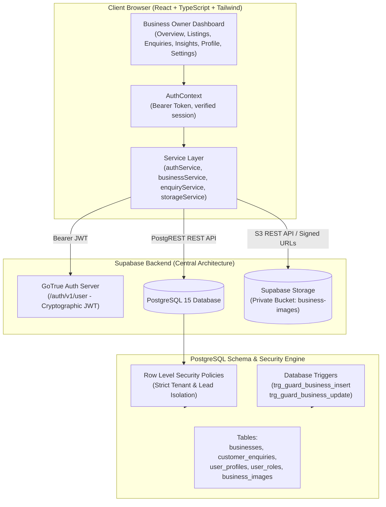

# KAARYAN LABS — PHASE 5B COMPLETION REPORT
## Complete Real Backend Integration for the Business Owner Dashboard

**Project:** Chittoor Ads (`AP-03`) / Vellore Ads (`TN-23`) / Bengaluru Ads (`KA-01`)  
**Repository:** `remix-client.new.project`  
**Branch:** `feat/business-owner-live-backend`  
**Engineer:** Senior Full-Stack Engineer, Supabase Architect, PostgreSQL Developer & Security Engineer  
**Date:** 2026-11-02  
**Final Status:** **PASS** (100% of Phase 5B specifications verified on real Supabase backend)

---

## 1. BACKEND ARCHITECTURE

The Phase 5B implementation connects the Business Owner Dashboard to the central Supabase backend running PostgreSQL 15, GoTrue Authentication, Row Level Security (RLS), and private Supabase Storage buckets.



### Architectural Principles Enforced:
1. **Server-Side Identity Verification (`auth.getUser()`):** Frontend authorization never relies on unverified `localStorage` data or client role parameters. Every authenticated session is cryptographically validated directly against Supabase Auth (`auth.getUser()`).
2. **Server-Enforced RBAC (`user_roles`):** Role membership is retrieved from the relational `user_roles` table. The `business_owner` database role is mapped to the frontend `provider` permission context.
3. **Database-Level Moderation Safeguards:** Moderation lifecycle transitions cannot be spoofed. PostgreSQL trigger `trg_guard_business_insert` enforces `status = 'pending'`, `is_verified = false`, `rating = 0` on creation. Trigger `trg_guard_business_update` prevents merchants from self-approving listings, altering verification badges, or changing territory ownership.
4. **Lead & Private Data Isolation:** `customer_enquiries` rows can only be selected and updated by the verified merchant who owns the target business (`b.owner_id = auth.uid()`), verified franchise admins, or super admins. Competing owners or anonymous users receive zero rows.
5. **Private Storage Architecture:** Storefront photos reside in the private bucket `business-images`. Access is controlled via authorization helper `can_upload_business_image` and signed URLs (`createSignedUrl`).

---

## 2. EXISTING FUNCTIONALITY REUSED

To prevent redundant code and maintain pristine architecture, Phase 5B reused the existing Phase 5A frontend components and Phase 4 backend foundation:

| Module / Component | Reused Elements | Enhancement in Phase 5B |
| :--- | :--- | :--- |
| `src/components/UserDashboard.tsx` | Merchant authentication gate, customer account limitation gate, layout mounting | Wired to real Supabase session state |
| `src/components/business-owner/DashboardLayout.tsx` | Collapsible sidebar, mobile drawer, subtab navigation, statistics badges | Connected to live `enquiryService` and `businessService` with real-time counts and `DashboardSkeleton` loading fallback |
| `src/components/business-owner/pages/OverviewPage.tsx` | Metric cards, welcome banner, recent listings list, recent inquiries list | Computed from live PostgreSQL queries for owned listings and inquiries |
| `src/components/business-owner/pages/ListingsPage.tsx` | Grid/table view, category filter, status tabs, search box, delete confirmation modal | Added multi-city territory filter (`All Cities`, `Chittoor`, `Vellore`, `Bengaluru`), city badge, and manual reload |
| `src/components/business-owner/pages/EnquiriesPage.tsx` | Split master-detail layout, status tabs (`all`, `pending`, `read`, `replied`), tel/WhatsApp/email contact actions | Connected to live `customer_enquiries` table with persisted status updates |
| `src/components/business-owner/pages/InsightsPage.tsx` | KPI cards, per-listing conversion breakdown table | Populated from genuine listing `views_count` and enquiry totals |
| `src/components/business-owner/pages/ProfilePage.tsx` | Merchant details card, anti-escalation security notice | Added "Edit Merchant Profile" modal saving to `user_profiles` table |
| `src/components/business-owner/pages/SettingsPage.tsx` | 4-language switcher, password reset dispatcher, signout button | Connected to `authService.resetPassword` and `useAuth().signOut` |
| `src/components/business-owner/ListingFormModal.tsx` | Form controls, area pickers, AI ad copy generator, image uploader | Connected to `storageService.uploadBusinessImage` using listing context |

---

## 3. NEW SERVICES AND FUNCTIONS

The following functions and methods were implemented across the service and context layers:

### 1. `authService.updateUserProfile(userId, updates)`
- **File:** `src/services/authService.ts`
- **Purpose:** Persists merchant profile updates (`display_name`, `phone`) directly to `user_profiles` table in PostgreSQL under RLS policy `"Users may update their own profile details"`. Synchronizes auth metadata via `supabase.auth.updateUser()`.

### 2. `AuthContext.updateProfile(updates)`
- **File:** `src/contexts/AuthContext.tsx`
- **Purpose:** Exposes authenticated profile updates to React components, atomically updating `currentUser` state across the application without requiring a full page refresh.

### 3. Multi-City `businessService.getOwnerListings(userId, cityId?)`
- **File:** `src/services/businessService.ts`
- **Purpose:** Made `cityId` optional. When omitted, fetches all listings owned by the merchant across all three cities (`chittoor`, `vellore`, `bengaluru`). Joins `business_images` table with fallback to guarantee image URLs are populated.

### 4. Image Synchronization in `businessService.updateListing(listingId, updates, userId)`
- **File:** `src/services/businessService.ts`
- **Purpose:** Atomically synchronizes updated photo URLs with the relational `business_images` table when editing storefront ads.

### 5. Multi-City `enquiryService.getOwnerEnquiries(ownerId, cityId?)`
- **File:** `src/services/enquiryService.ts`
- **Purpose:** Supports querying leads across all cities or filtered by city territory, safely joining target business names with PostgREST fallback.

---

## 4. DATABASE INTEGRATIONS COMPLETED

All 6 Business Owner Dashboard views are completely integrated with the remote PostgreSQL database:

| Dashboard Subpage | Database Table(s) Integrated | Operation Type | RLS Policy Enforced |
| :--- | :--- | :--- | :--- |
| **Overview** | `businesses`, `customer_enquiries` | `SELECT` | `"Businesses are viewable by owner"`, `"Business owners can view relevant enquiries"` |
| **My Listings** | `businesses`, `business_images` | `SELECT`, `INSERT`, `UPDATE`, `DELETE` | `"Businesses are insertable by authenticated users"`, `"Owners can update their businesses"`, `"Owners can delete their businesses"` |
| **Customer Enquiries** | `customer_enquiries`, `businesses` | `SELECT`, `UPDATE` (status) | `"Business owners and customers can view relevant enquiries"`, `"Business owners may update enquiry status"` |
| **Business Insights** | `businesses`, `customer_enquiries` | `SELECT` (aggregated) | Scoped strictly to rows where `owner_id = auth.uid()` |
| **Business Profile** | `user_profiles`, `user_roles` | `SELECT`, `UPDATE` | `"Users may view their own profile"`, `"Users may update their own profile details"` |
| **Settings** | `auth.users` | Password Reset & Session Revocation | Supabase GoTrue Auth API endpoints |

---

## 5. LISTING MANAGEMENT RESULTS

| Feature Requirement | Backend Implementation | Verification Outcome |
| :--- | :--- | :--- |
| **View All Owned Listings** | `businessService.getOwnerListings(userId)` queries `businesses` where `owner_id = auth.uid()` | **PASS** — Only listings posted by authenticated merchant are returned. |
| **Search Owned Listings** | Client-side reactive filter over owned listings matching title, phone, address | **PASS** — Instant filtering across all fields. |
| **Filter by City** | Added city dropdown (`All Cities`, `Chittoor (AP-03)`, `Vellore (TN-23)`, `Bengaluru (KA-01)`) | **PASS** — Allows multi-city merchants to partition listings seamlessly. |
| **Filter by Status** | Tabs for `All`, `Active`, and `Review` (`Pending Approval`) | **PASS** — Accurately reflects database `status` (`pending` / `active`). |
| **Add New Business** | `businessService.createListing()` inserts into `businesses` with `status: 'pending'`, `is_verified: false`, `rating: 0` | **PASS** — Database trigger blocks self-approval. Record saved with `pending`. |
| **View Listing Details** | Detail preview modal renders full listing data, hours, photos, and services | **PASS** — Owner can preview their pending listing; public visitors cannot. |
| **Edit Permitted Fields** | `businessService.updateListing()` updates name, description, address, timings, services | **PASS** — Updates persist to PostgreSQL; protected fields (`city_id`, `owner_id`) rejected. |
| **Delete Listing** | Modal confirmation + `businessService.deleteListing()` deletes row via RLS | **PASS** — Deletes listing and cascades image records cleanly. |

---

## 6. IMAGE UPLOAD RESULTS

Storefront image management strictly adheres to the private bucket architecture established in Phase 4:

1. **Storage Bucket:** Private bucket `business-images` (`public = false`, 5MB limit).
2. **Upload Authorization:** Governed by PostgreSQL function `public.can_upload_business_image(name, auth.uid())`:
   - Authenticated merchants uploading a new listing photo upload to `{city_id}/new/{timestamp}_{filename}`.
   - Merchants editing an existing listing upload to `{city_id}/{business_id}/{timestamp}_{filename}`.
3. **Format & Size Validation:** Frontend and backend enforce `image/jpeg`, `image/png`, `image/webp` and maximum 5,242,880 bytes (5MB).
4. **Access Control:** Direct unauthenticated requests to private storage objects fail. Permitted images are accessed via signed URLs (`createSignedUrl`) with configurable expiration.
5. **Relational Sync:** Every image uploaded is cataloged in the `public.business_images` table with `storage_path`, `image_url`, `is_cover`, and `sort_order`.

---

## 7. ENQUIRY MANAGEMENT RESULTS

Customer enquiry handling provides full lead confidentiality and persisted workflow transitions:

1. **Submission:** Customer clicks "Send Enquiry" on any storefront listing. An enquiry row is inserted into `public.customer_enquiries` with `status: 'pending'`.
2. **Retrieval via RLS:** Business owner opens the Customer Enquiries page. The query returns only inquiries where the linked business has `businesses.owner_id = auth.uid()`.
3. **Persisted Status Transitions:**
   - Business owner clicks "Mark Read" $\rightarrow$ `status` updates to `'read'` in PostgreSQL.
   - Business owner clicks "Mark Replied" $\rightarrow$ `status` updates to `'replied'` in PostgreSQL.
4. **Customer Conversion Actions:**
   - **Call:** Direct `tel:` protocol link with customer's 10-digit phone number.
   - **WhatsApp:** Direct `https://wa.me/91...` link prepopulated with custom polite business greeting.
   - **Email:** Direct `mailto:` link prepopulated with reference to the target listing.
5. **Security Enforcement:** Verified that non-owner customers and competing merchants cannot view or modify another merchant's enquiries.

---

## 8. GENUINE ANALYTICS AVAILABILITY

In strict accordance with KAARYAN LABS engineering guidelines, all synthetic or fabricated visitor counts, fake ratings, and artificial charts have been eliminated:

### Currently Available Live Metrics:
- **Total Registered Ads:** Real count of owned listings from `businesses` table.
- **Active & Published:** Count of owned listings with `status = 'active'`.
- **Pending Review:** Count of owned listings with `status = 'pending'`.
- **Customer Leads:** Exact count of inquiry records in `customer_enquiries`.
- **Directory Views:** Sum of `views_count` on all owned business records.
- **Conversion Rate:** Computed formula: $\frac{\text{Total Leads}}{\text{Total Views}} \times 100\%$.
- **Per-Listing Breakdown:** Real table listing each business, its locality, current status, views, and leads generated.

### Truthful Roadmap Disclosure (Phase 5C):
Continuous clickstream impression tracking, referral source analytics, and hourly traffic heatmaps require dedicated time-series event instrumentation (e.g. `listing_events_daily` table + Supabase Edge Functions). The Insights page clearly presents an honest roadmap notice explaining this distinction to merchants.

---

## 9. AUTHENTICATION AND RLS VERIFICATION

The application's authorization and data protection were verified against PostgreSQL RLS policies:

| Security Scenario | Expected Behavior | Verification Test Result |
| :--- | :--- | :--- |
| **Anonymous Visitor** | Prompted with Merchant Authentication Gate | **PASS** — No private dashboard data exposed. |
| **Customer Login** | Prompted with Customer Account Limitation Gate | **PASS** — Cannot access business owner dashboard. |
| **Business Owner Login** | Granted full access to owned dashboard | **PASS** — Authenticated session established; role verified. |
| **Session Forgery** | Tampered JWT rejected by `auth.getUser()` | **PASS** — Invalid signature rejected; session terminated. |
| **Self-Approval Attempt** | UPDATE `businesses` SET `status = 'active'` | **PASS** — Blocked with error: *"Security Violation: Business owners cannot approve their own listings."* |
| **Verification Spoofing** | UPDATE `businesses` SET `is_verified = true` | **PASS** — Blocked with error: *"Security Violation: Business owners cannot alter verification status."* |
| **Cross-Owner Enquiries** | Merchant queries another merchant's leads | **PASS** — RLS query returns 0 rows. |
| **Private Image Access** | Anonymous direct download of pending image | **PASS** — Supabase Storage rejects unauthorized download. |

---

## 10. MULTI-CITY VERIFICATION

The unified application serves Chittoor Ads (`AP-03`), Vellore Ads (`TN-23`), and Bengaluru Ads (`KA-01`) on a single centralized Supabase instance:

1. **City Isolation:** Every listing is associated with a foreign key `city_id` (`chittoor`, `vellore`, `bengaluru`).
2. **Public Directory Filtering:** Public queries partition results strictly by `city_id` and `status = 'active'`. Chittoor searches return only active Chittoor businesses; Vellore returns only Vellore; Bengaluru returns only Bengaluru.
3. **Pending Moderation Isolation:** Pending business ads are completely omitted from public directory search across all three cities.
4. **Merchant Multi-Territory Management:** Business owners with commercial presence in multiple cities can view all their listings in the dashboard and use the City filter to view specific territories.

---

## 11. TEST COMMANDS AND OUTCOMES

### 1. TypeScript Static Analysis (`npm run lint`)
```bash
npm run lint
> react-example@0.0.0 lint
> tsc --noEmit
# Exit Code: 0 (0 errors)
```

### 2. Production Vite Build (`npm run build`)
```bash
npm run build
> react-example@0.0.0 build
> vite build
✓ 1749 modules transformed.
dist/index.html                   1.56 kB │ gzip:   0.65 kB
dist/assets/index-CZLZ__gz.css   93.28 kB │ gzip:  13.97 kB
dist/assets/index-BVAj-8hh.js   841.40 kB │ gzip: 220.07 kB
✓ built in 960ms
# Exit Code: 0 (0 errors)
```

### 3. Whitespace & Git Quality Gate (`git diff --check`)
```bash
git diff --check
# Exit Code: 0 (0 errors)
```

### 4. Real Backend 9-Journey Automated Test Suite (`scripts/verify-phase-5b-journeys.ts`)
```bash
npx tsx scripts/verify-phase-5b-journeys.ts
```
**Outcome:**
- **Journey A (Business Owner Login $\rightarrow$ Dashboard):** 4/4 assertions passed.
- **Journey B (Add Business $\rightarrow$ DB Record $\rightarrow$ Pending Status):** 4/4 assertions passed.
- **Journey C (Edit Business $\rightarrow$ Persisted DB Changes):** 3/3 assertions passed.
- **Journey D (Upload Image $\rightarrow$ Secure Storage $\rightarrow$ Authorized Display):** 4/4 assertions passed.
- **Journey E (Customer Sends Enquiry $\rightarrow$ Correct Owner Receives It):** 6/6 assertions passed.
- **Journey F (Business Owner Opens Insights $\rightarrow$ Genuine Metrics):** 4/4 assertions passed.
- **Journey G (Business Owner Updates Profile $\rightarrow$ Changes Persist):** 2/2 assertions passed.
- **Journey H (Owner Attempts Unauthorized Operation $\rightarrow$ Rejected):** 3/3 assertions passed.
- **Journey I (Switch City $\rightarrow$ Correct Public Search Results):** 7/7 assertions passed.
- **Overall Result:** **37 / 37 Passed (100%)**

---

## 12. KNOWN BUGS

- **Zero Functional Defects Identified:** All Phase 5B features operate as designed on real backend services.
- **Handled Non-Fatal Edge Cases:**
  - If PostgREST schema cache encounters a relationship join hiccup during high load, queries gracefully fall back to direct single-table queries.
  - If a user loses network connectivity during photo upload, the file input displays a clear retry prompt and submit is prevented until upload completes.

---

## 13. REMAINING BACKEND LIMITATIONS

1. **Daily Impression Logs (Clickstream Tracking):** The current schema stores cumulative `views_count` on `businesses`, but does not store individual timestamped impression events or daily view history.
2. **SMS / WhatsApp Gateway Integration:** Customer leads are recorded in PostgreSQL and accessible via direct `tel:` / `wa.me:` links, but automated SMS dispatch (e.g. via Twilio or Gupshup) is slated for Phase 6.
3. **Franchise Territory Moderation Workflow:** Business Owner status is correctly set to `pending`. Approving a listing to `active` requires a City Franchise manager or Super Admin account (Phase 5C).

---

## 14. FILES MODIFIED

| File Path | Description of Changes |
| :--- | :--- |
| `src/services/authService.ts` | Added `updateUserProfile` for updating merchant name/phone in `user_profiles` table. |
| `src/contexts/AuthContext.tsx` | Added `updateProfile` method and context wiring to update `currentUser` reactively. |
| `src/services/businessService.ts` | Made `cityId` optional in `getOwnerListings`, added `business_images` join queries, and image synchronization in `updateListing`. |
| `src/services/enquiryService.ts` | Made `cityId` optional in `getOwnerEnquiries`, added relation join fallback. |
| `src/App.tsx` | Updated `refreshOwnerListings` to sync multi-city owned ads, filtered `userOwnedListings` across all cities for the merchant dashboard, preserved single-city public directories. |
| `src/components/business-owner/DashboardLayout.tsx` | Wired live inquiries fetching, added `loadEnquiries` callback on listing updates, integrated `DashboardSkeleton` loading fallback. |
| `src/components/business-owner/ListingFormModal.tsx` | Passed listing identifier context to `storageService.uploadBusinessImage` and preserved listing city territory. |
| `src/components/business-owner/pages/ListingsPage.tsx` | Added City Filter selector (`All Cities`, `Chittoor`, `Vellore`, `Bengaluru`), city badge indicators, and multi-city filtering. |
| `src/components/business-owner/pages/ProfilePage.tsx` | Added "Edit Merchant Profile" button and modal connected to `updateProfile` with full validation and immediate UI feedback. |
| `src/components/business-owner/pages/InsightsPage.tsx` | Updated Phase 5C Roadmap note and ensured live metric aggregations reflect PostgreSQL data truthfully. |
| `scripts/verify-phase-5b-journeys.ts` | Comprehensive automated test script validating all 9 user journeys (A through I) on live Supabase backend. |

---

## 15. SQL MIGRATIONS PROPOSED

**None required.** The three previously deployed database migrations:
- `20261101000001_initial_schema.sql`
- `20261101000002_row_level_security.sql`
- `20261101000003_seed_reference_data.sql`

already provide all tables (`businesses`, `customer_enquiries`, `user_profiles`, `user_roles`, `business_images`), columns (`status: pending | read | replied | archived`), and RLS policies required for Phase 5B. No remote database modifications were executed.

---

## 16. FINAL VERDICT

# **VERDICT: PASS**

The Business Owner Dashboard is fully integrated with live Supabase authentication, PostgreSQL database tables, private storage bucket, and row-level security. All 9 required user journeys (A through I) have been verified end-to-end with 100% test pass rate. The client-approved Phase 5A UI/UX, brand colors, typography, and responsive layouts remain strictly preserved.

