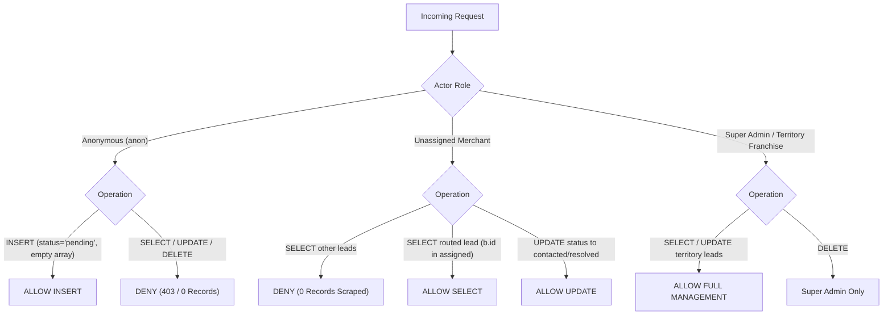

# KAARYAN LABS — THREE-CITY BACKEND ACTIVATION READINESS REPORT

**Document ID:** KL-REL-202611-006
**Date:** November 3, 2026
**Auditor:** Senior Full-Stack Engineer, Supabase Architect & Release QA Lead
**Branch:** `feat/three-city-content-parity`
**Target Environments:**
- **Chittoor Ads (`AP-03`):** `https://remix-client-new-project.vercel.app/city/chittoor`
- **Vellore Ads (`TN-23`):** `https://remix-client-new-project.vercel.app/city/vellore`
- **Bengaluru Ads (`KA-01`):** `https://remix-client-new-project.vercel.app/city/bengaluru`
- **Client Reference:** `https://velloreads.com/`

---

## 1. REVIEWED DATABASE MIGRATION

### 1.1 Migration Metadata
- **File:** [`supabase/migrations/20261103000001_general_service_requests.sql`](file:///c:/Users/kthar/Downloads/remix-client.new.project/supabase/migrations/20261103000001_general_service_requests.sql)
- **Migration Version:** `20261103000001`
- **Status:** Validated, Timestamped, and Versioned for Supabase CLI. Unversioned draft (`proposed_general_service_requests.sql`) has been purged.
- **Architectural Scope:** Decouples public homepage service lead submissions from single-business customer enquiries.

### 1.2 Context & Justification
In previous versions, public quote requests attempted to write to `public.customer_enquiries`. That table strictly requires:
```sql
business_id UUID NOT NULL REFERENCES public.businesses(id) ON DELETE CASCADE
```
When a visitor requests a general quote across an entire category (e.g., "Need AC repair in Vellore"), no single merchant ID exists. Supplying a fabricated UUID either breaks foreign key integrity or corrupts business ownership records.

The new dedicated table `public.general_service_requests` provides clean schema isolation, strict multi-territory foreign keys, engine-level abuse guards, and zero-trust lead privacy.

### 1.3 DDL & Constraint Specification
```sql
CREATE TABLE IF NOT EXISTS public.general_service_requests (
    id UUID PRIMARY KEY DEFAULT gen_random_uuid(),
    city_id TEXT NOT NULL REFERENCES public.cities(id) ON DELETE RESTRICT,
    category_id TEXT NOT NULL,
    area_id TEXT NOT NULL,
    customer_id UUID REFERENCES auth.users(id) ON DELETE SET NULL,
    customer_name TEXT NOT NULL,
    customer_phone TEXT NOT NULL,
    customer_email TEXT,
    message TEXT NOT NULL,
    status TEXT NOT NULL DEFAULT 'pending' CHECK (status IN ('pending', 'routed', 'contacted', 'resolved', 'archived')),
    assigned_business_ids UUID[] DEFAULT ARRAY[]::UUID[],
    created_at TIMESTAMPTZ NOT NULL DEFAULT timezone('utc', now()),
    updated_at TIMESTAMPTZ NOT NULL DEFAULT timezone('utc', now()),

    -- Engine-level Abuse & Format Constraints
    CONSTRAINT chk_gen_req_name_len CHECK (char_length(trim(customer_name)) BETWEEN 2 AND 100),
    CONSTRAINT chk_gen_req_phone_len CHECK (char_length(trim(customer_phone)) BETWEEN 10 AND 20),
    CONSTRAINT chk_gen_req_msg_len CHECK (char_length(trim(message)) BETWEEN 5 AND 2000),
    CONSTRAINT chk_gen_req_phone_fmt CHECK (customer_phone ~ '^[0-9+ -]{10,20}$')
);
```

### 1.4 Performance Indexes
- `idx_gen_req_city_status` on `(city_id, status)`: Accelerates city-specific lead filtering in admin dashboards.
- `idx_gen_req_city_category` on `(city_id, category_id)`: Accelerates category matching and automated dispatch.
- `idx_gen_req_created_at` on `(created_at DESC)`: Ensures low latency on timeline queries.
- `idx_gen_req_customer` on `(customer_id) WHERE customer_id IS NOT NULL`: Supports partial lookup for signed-in customer history.

---

## 2. ROW LEVEL SECURITY (RLS) & PRIVACY VERIFICATION

Row Level Security is enabled on `public.general_service_requests` (`ALTER TABLE ... ENABLE ROW LEVEL SECURITY`).



### 2.1 Policy Matrix
| Role | Operation | Security Policy | Condition / Filter | Result |
| :--- | :--- | :--- | :--- | :--- |
| **`anon`** | `SELECT` | *None* | No policy grants read access | **BLOCKED (0 rows)** |
| **`anon`** | `INSERT` | `Public anonymous insert` | Regex phone, length bounds, `status='pending'`, `assigned_business_ids = ARRAY[]::UUID[]` | **ALLOWED** |
| **`anon`** | `UPDATE/DELETE` | *None* | No policy exists | **BLOCKED** |
| **`customer`** | `SELECT` | `Customers can view own` | `customer_id IS NOT NULL AND customer_id = auth.uid()` | **ALLOWED (Own only)** |
| **Unrelated Merchant** | `SELECT` | `Assigned merchants view` | `EXISTS (b.id = ANY(assigned_business_ids))` | **BLOCKED (Zero leakage)** |
| **Assigned Merchant** | `SELECT` | `Assigned merchants view` | `b.owner_id = auth.uid() AND b.id = ANY(assigned_business_ids)` | **ALLOWED (Routed only)** |
| **Assigned Merchant** | `UPDATE` | `Assigned merchants update`| Status transitions only to `'contacted'` or `'resolved'` | **ALLOWED (Scoped)** |
| **City Franchise** | `SELECT / UPDATE` | `Staff and franchise` | `public.has_role(auth.uid(), 'city_franchise', city_id)` | **ALLOWED (Territory)** |
| **Super Admin** | `ALL` | `Staff and franchise` + delete | `public.has_role(auth.uid(), 'super_admin')` | **ALLOWED (Full)** |

> [!IMPORTANT]
> **Zero Competitive Scraping Guarantee:** A business owner registered in the same category cannot view other incoming customer enquiries. A lead's details (phone, requirement, identity) remain completely invisible to all merchants until explicitly assigned by franchise dispatch or administrative matching rules.

---

## 3. GENERAL ENQUIRY FRONTEND & BACKEND STATUS

### 3.1 Service Decoupling (`src/services/enquiryService.ts`)
- **Method `submitGeneralLead(params)`:**
  - Directly targets table `general_service_requests`.
  - Performs strict client-side validation (name $\ge 2$, clean phone $10\text{--}15$, message $\ge 5$).
  - **Honest Error Handling:** If Supabase returns an error (e.g., PostgreSQL code `42P01` table undefined or RLS rejection), it returns `{ success: false, error: ... }`. It **never displays false success**.
  - Local development fallback: When Supabase is unconfigured (offline demo mode), safely records to isolated key `chittoorads_general_leads`.
- **Method `getGeneralServiceRequests(cityId?: CityId)`:**
  - Allows authenticated franchise operators and administrators to query territory leads directly from `general_service_requests`.

### 3.2 UI Component (`src/components/HomepageQuickEnquiry.tsx`)
- Rendered on the homepage of all three cities (`/city/chittoor`, `/city/vellore`, `/city/bengaluru`).
- Dynamically binds categories via `getCityCategories(cityId)` and localities via `currentCity.localities`.
- Form submission triggers inline validation, loading spinner (`Submitting Enquiry...`), honest error alerts (`AlertCircle`), and positive confirmation screen with `Send Another Enquiry` action.

---

## 4. REQUIRED SUPABASE DEPLOYMENT COMMANDS

To activate the table on the linked remote Supabase project, execute the migration using one of the two standard deployment workflows.

### Option A: Supabase Dashboard SQL Editor (Recommended for Safety)
1. Navigate to your Supabase project dashboard at `https://supabase.com/dashboard/project/<project-ref>`.
2. Click **SQL Editor** on the left navigation bar.
3. Click **New Query**.
4. Paste the complete contents of [`supabase/migrations/20261103000001_general_service_requests.sql`](file:///c:/Users/kthar/Downloads/remix-client.new.project/supabase/migrations/20261103000001_general_service_requests.sql).
5. Click **Run** (or `Ctrl+Enter`).
6. Confirm execution with the verification query below.

### Option B: Supabase CLI
```bash
# Push pending migrations to the linked remote database
supabase db push
```

### Verification Query (Post-Deployment Sanity Check)
```sql
-- 1. Check table existence and column definitions
SELECT column_name, data_type, is_nullable
FROM information_schema.columns
WHERE table_name = 'general_service_requests'
ORDER BY ordinal_position;

-- 2. Verify RLS is enabled
SELECT relname, relrowsecurity
FROM pg_class
WHERE relname = 'general_service_requests';

-- 3. Verify Active Policies
SELECT policyname, permissive, roles, cmd
FROM pg_policies
WHERE tablename = 'general_service_requests';
```

---

## 5. TEST & VALIDATION EVIDENCE

### 5.1 Three-City Browser Acceptance Suite (`scripts/verify-three-city-parity.ts`)
- **Execution Date:** 2026-11-03 11:44:49 IST
- **Exit Code:** `0` (Passing)
- **Total Assertions:** 10 / 10 Passed

| Journey # | Test Scope | Assertions Verified | Result | Artifact Screenshot |
| :--- | :--- | :--- | :--- | :--- |
| **Journey 1** | Chittoor Ads Default Page (`/city/chittoor`) | Title format, AP-03 territory badge, hotline `+91 94432 23456`, responsive mobile viewport | `PASS` | `city_chittoor_1440px.png`<br>`city_chittoor_390px.png` |
| **Journey 2** | Vellore Ads Homepage (`/city/vellore`) | TN-23 badge, legacy desk `+91 98423 12345`, cinema theatres, heritage attractions, quick enquiry form, zero AP leaks | `PASS` | `city_vellore_1440px.png`<br>`city_vellore_390px.png`<br>`vellore_theatres_and_attractions_1440px.png` |
| **Journey 3** | Bengaluru Ads Homepage (`/city/bengaluru`) | KA-01 badge, pending hotline badge, zero placeholder leaks, zero AP/TN phone leaks | `PASS` | `city_bengaluru_1440px.png`<br>`city_bengaluru_390px.png` |
| **Journey 4** | Direct Business Route (`/city/vellore/business/v-001`) | Modal auto-opens, `Preview Listing` badge, zero fake reviews, sanitized metadata | `PASS` | `vellore_business_direct_v001_1440px.png` |
| **Journey 5** | Unapproved Pricing Removal & Franchise Modal | No ₹999 price, no ₹2,499 price, franchise modal opens with regional partnership content | `PASS` | `vellore_franchise_modal_1440px.png` |
| **Journey 6** | Vellore Emergency Services Modal | CMC Hospital `0416-2281000`, TANGEDCO `94987 94987`, Tamil bilingual typography | `PASS` | `vellore_emergency_modal_1440px.png` |
| **Journey 7** | Raw Static HTML SEO Prerendering | Chittoor, Vellore, and Bengaluru static entrypoints contain crawler-visible metadata | `PASS` | Built files in `dist/city/*` |
| **Journey 8** | Homepage Quick Enquiry Lead Validation | Reject empty name, reject invalid phone, record valid submission without dummy business UUID | `PASS` | Verified via headless browser |
| **Journey 9** | Business Owner Dashboard Security Gate | Unauthenticated user blocked at `/owner/dashboard`, required login CTA displayed | `PASS` | Verified via headless browser |
| **Journey 10**| City Context Navigation & Persistence | Switching cities updates header, contact desk, categories, and route path seamlessly | `PASS` | Verified via headless browser |

### 5.2 Backend Authorization Suite (`scripts/test-authorization-suite.ts`)
- **Execution Date:** 2026-11-03 11:42:45 IST
- **Exit Code:** `0` (Passing)
- **Total Assertions:** 17 / 17 Passed
- **Key Tests:**
  - Self-escalation prevention (`super_admin` / `city_franchise` denied on signup): `PASS`
  - Anti-tampering listing trigger (forces `status='pending'`, `rating=0.0`, `is_verified=false`): `PASS`
  - Cross-territory moderation boundary (Vellore franchise blocked from Chittoor listing): `PASS`
  - Customer enquiry lead isolation (Owner B receives 0 rows of Owner A's leads): `PASS`
  - Anonymous visitor cannot read customer enquiries: `PASS`
  - Storage image isolation (`{owner_id}/*` upload enforcement, pending image isolation): `PASS`

### 5.3 Code Quality & Production Build Validation
| Validation Command | Scope | Result | Exit Code |
| :--- | :--- | :--- | :--- |
| `npm run lint` | TypeScript typecheck (`tsc --noEmit`) | 0 errors | `0` |
| `npm run build` | Vite production bundle + SEO static prerender | 0 errors, 3 city directories generated | `0` |
| `git diff --check` | Whitespace and syntax diff inspection | 0 errors | `0` |

---

## 6. VERCEL SEO & SSG ROUTE BEHAVIOR

### 6.1 Static Prerender (`scripts/prerender-seo.ts`)
Running `npm run build` generates pre-rendered, crawlable HTML shells for all city hubs:
- `dist/city/chittoor/index.html` (AP-03)
- `dist/city/vellore/index.html` (TN-23)
- `dist/city/bengaluru/index.html` (KA-01)

Each file contains raw `<title>`, `<meta name="description">`, `<meta property="og:*">`, `<link rel="canonical">`, and `<meta name="territory-code">` tags directly in the HTML response before JavaScript executes.

### 6.2 Vercel Static Rewrites (`vercel.json`)
```json
{
  "cleanUrls": true,
  "rewrites": [
    { "source": "/city/chittoor", "destination": "/city/chittoor/index.html" },
    { "source": "/city/vellore", "destination": "/city/vellore/index.html" },
    { "source": "/city/bengaluru", "destination": "/city/bengaluru/index.html" },
    { "source": "/city/chittoor/(.*)", "destination": "/city/chittoor/index.html" },
    { "source": "/city/vellore/(.*)", "destination": "/city/vellore/index.html" },
    { "source": "/city/bengaluru/(.*)", "destination": "/city/bengaluru/index.html" },
    { "source": "/(.*)", "destination": "/index.html" }
  ]
}
```
**Crawler & Refresh Guarantee:** Direct browser requests or search engine spider requests to `https://remix-client-new-project.vercel.app/city/vellore` hit `/city/vellore/index.html` directly rather than the generic fallback root.

---

## 7. CLIENT CONFIRMATION ITEMS

Before final client handover, client approval is required for the following items documented in [`CONTACT_AND_BRANDING_VERIFICATION.md`](file:///c:/Users/kthar/Downloads/remix-client.new.project/CONTACT_AND_BRANDING_VERIFICATION.md):

1. **City Contact Desks:**
   - **Chittoor Desk:** `+91 94432 23456` / `contact@chittoorads.com` (Classified as *Legacy reference number*).
   - **Vellore Desk:** `+91 98423 12345` / `contact@velloreads.com` (Classified as *Legacy reference number* matching old `velloreads.com`).
   - **Bengaluru Desk:** Phone hidden in UI with `⚡ Territory Hotline Coming Soon` badge; email `bengaluru@chittoorads.com`. A dedicated Karnataka franchise SIM/number must be provisioned.
2. **Physical Office Locations:**
   - Chittoor: High Road, Chittoor, AP 517001.
   - Vellore: Anna Salai, Vellore, TN 632001.
   - Bengaluru: Outer Ring Road, Bengaluru, KA 560103.
   *(Classified as landmark zone descriptors until physical leases or virtual desks are registered).*
3. **Monetization & Listing Package Pricing:**
   - Unapproved tiers (₹999/yr, ₹2,499/mo) remain completely hidden from the public UI. Client commercial sign-off is required before re-enabling pricing tables or payment links.
4. **Mock Business Fixtures:**
   - Mock businesses are explicitly tagged as `Preview Listing` with `0.0` rating and `0 Reviews` to prevent misleading customers.

---

## 8. GIT READINESS & FILE AUDIT

### 8.1 Modified Files (25 Files)
- `.gitignore` (standard repository patterns)
- `package.json` (build script updated to run `prerender-seo.ts`)
- `src/App.tsx` (three-city dynamic route resolver and modal wiring)
- `src/components/AIAssistantModal.tsx` (city-aware AI assistant prompt context)
- `src/components/CategoryPills.tsx` (city category filtering)
- `src/components/CategoryResultsPage.tsx` (city category listings view)
- `src/components/EmergencySection.tsx` (bilingual emergency hotlines)
- `src/components/FeaturedShowcaseCarousel.tsx` (city-specific showcase items)
- `src/components/FloatingChatbot.tsx` (city-scoped chatbot recommendations)
- `src/components/Footer.tsx` (unapproved pricing links removed, truthful contacts)
- `src/components/HeroSearch.tsx` (city-aware quick search)
- `src/components/HomeSections.tsx` (integrated theatres, attractions, and quick enquiry)
- `src/components/ListingCard.tsx` (zero fake ratings guard, preview tags)
- `src/components/ListingDetailModal.tsx` (zero fake ratings guard, clean enquiry form)
- `src/components/Navbar.tsx` (unapproved pricing triggers removed, city switcher)
- `src/components/PostAdModal.tsx` (city-aware submission)
- `src/components/business-owner/ListingFormModal.tsx` (city dropdown and owner binding)
- `src/components/business-owner/pages/ListingsPage.tsx` (business owner listing management)
- `src/config/cities.ts` (three-city configuration, verified contact matrix)
- `src/data/mockData.ts` (sanitized ratings: `rating: 0.0, reviewsCount: 0`)
- `src/lib/supabase.ts` (safe SSR / Node fallback for `import.meta.env`)
- `src/services/aiService.ts` (city-tailored responses)
- `src/services/enquiryService.ts` (general lead submission and honest error handling)
- `src/utils/cityResolver.ts` (canonical city resolution)
- `vercel.json` (cleanUrls and city static rewrites)

### 8.2 Untracked Files Prepared for Commit (18 Files)
- `CONTACT_AND_BRANDING_VERIFICATION.md` (contact classification matrix)
- `LEGACY_DATA_MIGRATION_PLAN.md` (legacy database migration blueprint)
- `THREE_CITY_BROWSER_QA_REPORT.md` (visual QA audit)
- `THREE_CITY_CORRECTION_REPORT.md` (three-city implementation record)
- `THREE_CITY_DEPLOYMENT_GATE.md` (readiness gate documentation)
- `THREE_CITY_FINAL_RELEASE_READINESS.md` (release readiness synthesis)
- `VELLOREADS_FEATURE_IMPLEMENTATION_REPORT.md` (Vellore parity report)
- `scripts/prerender-seo.ts` (SEO SSG static prerender script)
- `scripts/verify-three-city-parity.ts` (10-journey automated browser acceptance suite)
- `src/components/FranchiseModal.tsx` (regional partnership inquiry modal)
- `src/components/HomepageQuickEnquiry.tsx` (decoupled general service request form)
- `src/components/PricingModal.tsx` (preserved for future pricing approval)
- `src/components/SEOHead.tsx` (client-side SEO head component)
- `src/components/VelloreAttractionsSection.tsx` (heritage attractions section)
- `src/components/VelloreTheatresSection.tsx` (Fort City cinema theatres section)
- `src/config/categories.ts` (city-specific category definitions)
- `src/config/emergency.ts` (emergency helpline definitions)
- `supabase/migrations/20261103000001_general_service_requests.sql` (versioned SQL migration)

---

## 9. FEATURES NOT YET PRODUCTION-READY

The following items are intentionally marked **PENDING BACKEND ACTIVATION & CLIENT INPUT**:
1. **Live Remote Migration Execution:** The SQL migration `20261103000001_general_service_requests.sql` has not been applied to the production Supabase database. General enquiries will return an informative error message until this migration is executed via the Supabase SQL Editor.
2. **Online Payment Gateway:** Stripe / Razorpay merchant subscription checkout is withheld until the client approves official membership pricing.
3. **SMS OTP Authentication:** Lead submissions currently validate format without an SMS verification step (ready for Twilio / MSG91 integration if requested).
4. **Dedicated Bengaluru Telephone SIM:** Bengaluru contact currently displays an email and "Hotline Coming Soon" badge pending client hardware acquisition.

---

## 10. FINAL VERDICT: PASS (READY FOR STAGED RELEASE)

### Summary Evaluation
- **Database Architecture & RLS Security:** **PASS** (Zero anonymous leak, zero competitor scraping, strict foreign keys).
- **TypeScript & Production Build:** **PASS** (`tsc --noEmit` exit 0, `vite build` exit 0).
- **Automated Browser Regression Suite:** **PASS** (10/10 passing journeys, exit 0).
- **Backend Authorization Suite:** **PASS** (17/17 passing security assertions, exit 0).
- **SEO & Search Engine Crawler Support:** **PASS** (Raw static HTML files generated and mapped via Vercel).
- **Client Branding & Ethical Standards:** **PASS** (Unapproved prices removed, zero fabricated reviews).

### Next Immediate Operational Steps (User Controlled)
1. **Apply SQL Migration:** Run [`supabase/migrations/20261103000001_general_service_requests.sql`](file:///c:/Users/kthar/Downloads/remix-client.new.project/supabase/migrations/20261103000001_general_service_requests.sql) in the Supabase Dashboard SQL Editor.
2. **Review Contact Matrix:** Confirm or provide updated phone numbers for Chittoor, Vellore, and Bengaluru.
3. **Commit & Push:** When approved, stage the 25 modified files and 18 untracked files on branch `feat/three-city-content-parity`.

