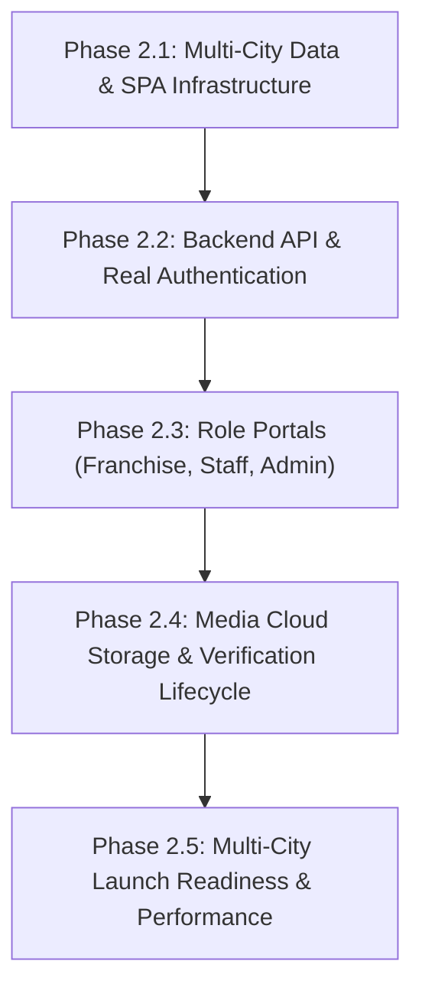

# KAARYAN LABS — Deployed Website Audit & Quality Assurance Report

**Project:** Chittoor Ads / Vellore Ads / Bengaluru Ads Multi-City Platform  
**Live Deployed Website:** [https://remix-client-new-project.vercel.app/](https://remix-client-new-project.vercel.app/)  
**Repository:** `remix-client.new.project`  
**Technology Stack:** React 19, TypeScript, Vite 8, Tailwind CSS v4, Lucide Icons  
**Review Lead:** Senior Full-Stack Engineer, Quality Assurance Lead & UI/UX Reviewer, KAARYAN LABS  
**Audit Date:** 31 October 2026  
**Evaluation Scope:** Codebase inspection (Phase 1.5 baseline), live Vercel deployment verification, Chrome CDP automated testing across 6 viewport widths (320px–1440px), functional customer testing, role permissions analysis, security audit, and multi-city roadmap assessment.

---

## 1. Executive Summary

The deployed Vercel web application represents a functional and visually appealing **Single-City Discovery Prototype** focused on **Chittoor District (AP-03)**. 

### Key Audit Findings:
1. **Deployment Parity:** The live Vercel deployment (`https://remix-client-new-project.vercel.app/`) exactly matches the current local repository, including all Phase 1.5 stabilization fixes (`dist/assets/index-CmZbCjJb.js` [848.18 kB] and `dist/assets/index-BH4w50QR.css` [74.36 kB]).
2. **Phase 1.5 Fixes Verified Active:** React hook ordering violations in modals have been resolved; History API URL synchronization (`/category/:id`, `?q=`, `?area=`, `?verified=1`, `?rating=4`, `?sort=`, `?saved=1`, `?listing=:id`) is operational; saved bookmark filtering now functions accurately; and basic phone format validation is active.
3. **Single-City Limitation:** Despite project specifications requiring a multi-city platform (Chittoor Ads, Vellore Ads, Bengaluru Ads), the deployed platform currently has **zero multi-tenant architecture**. All 10 listings, 16 localities, and branding assets are hardcoded to Chittoor. There are no city switchers, separate tenant schemas, or Vellore/Bengaluru landing portals.
4. **Missing Role Portals:** Out of four administrative personas required for the enterprise platform:
   - **Business Owner:** Only a rudimentary frontend table exists; it displays *all platform listings* rather than user-owned listings.
   - **City Franchise:** **0% implemented** (no pages, models, or workflows).
   - **Data Entry Staff:** **0% implemented** (no verification queue or field agent tools).
   - **Super Admin:** **0% implemented** (no city provisioning, moderation, or taxonomy controls).
5. **Security & Data Integrity:** There is currently no backend server or database connected. Authentication is a client-side simulation storing plain JSON in browser `localStorage`. Any user can impersonate a merchant or delete directory records from their browser. Paid Gemini AI keys are exposed to the client if configured via `VITE_` variables.

---

## 2. Screens Reviewed

The following screens, modals, and interaction states were thoroughly audited on the live Vercel deployment and local codebase:

| Screen / Component | Route / Trigger | Verification Status | Artifacts / Screenshots Captured |
|---|---|---|---|
| **Homepage (Desktop 1440px)** | `/` | Verified Working | `homepage_1440px.png` |
| **Homepage (Tablet 1024px)** | `/` | Verified Working | `homepage_1024px.png` |
| **Homepage (Tablet Portrait 768px)**| `/` | Verified Working | `homepage_768px.png` |
| **Homepage (Mobile 390px - iPhone 13/14)** | `/` | Verified Working | `homepage_390px.png` |
| **Homepage (Mobile 375px - iPhone SE)** | `/` | Verified Working | `homepage_375px.png` |
| **Homepage (Mobile 320px - Narrow)** | `/` | Verified Working | `homepage_320px.png` |
| **Category Results Page** | `/category/hotels-lodges` | Verified Working | `category_hotels.png` |
| **Search Results Page** | `/category/all?q=Hospital` | Verified Working | `search_hospital.png` |
| **Saved Bookmarks Page** | `/category/all?saved=1` | Verified Working | `saved_bookmarks.png` |
| **Business Details Modal** | `/?listing=c-001` | Verified Working | `listing_detail_modal.png` |
| **360° Virtual Tour Tab** | Detail Modal > "360 View" | Simulated UI Verified | `listing_360_view.png` |
| **Write Review Tab** | Detail Modal > "Write Review" | Simulated UI Verified | `listing_write_review.png` |
| **Sign In / Registration Modal** | Header > "Login / Register" | Simulated UI Verified | `login_modal.png` |
| **Post Free Ad Modal** | Header > "+ Post an Ad" | Simulated UI Verified | `post_ad_modal.png` |
| **24x7 Emergency Helplines Modal** | Top Strip > "Emergency Helplines"| Verified Working | `emergency_modal.png` |
| **Floating Chatbot Widget** | Bottom-Right Floating Bubble | Verified Working | `floating_chatbot.png` |
| **AI Scout Assistant Modal** | Top Strip / Hero > "AI Scout" | Verified Working | Rendered in modal shell |
| **Language Selection Menu** | Top Strip > Language Pill | Verified Working | `language_dropdown.png` |
| **Urdu RTL Layout Mirroring** | Language > Urdu (`ur`) | Verified Working | `homepage_urdu_rtl.png` |
| **Classifieds & Used Deals** | `/classifieds` | Verified Working | `classifieds_page.png` |
| **Kanipakam Special Pilgrimage** | `/kanipakam` | Verified Working | `kanipakam_page.png` |
| **Business Owner Dashboard** | `/dashboard/my-ads` | Partial Frontend Shell | `dashboard_page.png` |
| **City Franchise Portal** | `/franchise/*` | **MISSING (Not Implemented)** | None |
| **Data Entry Staff Portal** | `/staff/*` | **MISSING (Not Implemented)** | None |
| **Super Admin Platform Console** | `/admin/*` | **MISSING (Not Implemented)** | None |

---

## 3. Features Verified Working

The following capabilities have been tested and confirmed operational on the live deployed build:

1. **Brand Identity & Color Consistency:**
   - The client's distinctive **Red, Blue, Green, and Amber/Yellow** palette is consistently executed across all UI components:
     - **Crimson/Red (`#DC2626` / `#E11D48`):** Primary brand pin, "+ Post an Ad" CTA buttons, emergency helplines, active navigation indicators, and error highlights.
     - **Royal Blue (`#2563EB`):** Secondary brand elements, AI search accents, RedbackAI chatbot branding, and dashboard metric containers.
     - **Emerald Green (`#059669`):** Verified business shields, WhatsApp direct links, live status pills, and high-trust indicators.
     - **Amber / Yellow (`#F59E0B` / `#D97706`):** Customer review star ratings, promotional discount pills, and AI assistant badges.

2. **Unified Search & In-Memory Filtering:**
   - Keyword search operates across business title, category, description, address, and individual services.
   - Filtering by specific locality (e.g., Gandhi Road, Kanipakam, Kattamanchi) correctly isolates matching businesses.
   - Minimum rating filter (e.g., 4+ Stars) and Verified-Only filter work reactively without page reloads.
   - Sorting options ("Highest Rated", "Most Reviewed", "Recently Added") correctly re-order directory items.
   - Empty-result fallback renders when no items match criteria, presenting a "Reset Filters" action.

3. **URL Synchronization & Deep Linking (Phase 1.5):**
   - Direct navigation to `/category/hotels-lodges` correctly displays the Hotels category.
   - Filter criteria persist in URL search parameters (`?q=`, `?area=`, `?verified=1`, `?rating=4`, `?sort=latest`).
   - Browser Back and Forward buttons correctly trigger popstate handlers and restore state without desynchronizing the view.
   - Selecting a business populates `?listing=c-001`, enabling shareable direct URLs.

4. **Saved Businesses / Bookmarks:**
   - Clicking bookmark icons on cards saves/removes listing IDs in `localStorage`.
   - The header bookmark badge increments/decrements reactively.
   - The bookmark toggle displays the saved directory view (`?saved=1`) and shows "0 Listed" when the bookmark collection is empty.

5. **Direct External Communication Actions:**
   - Clicking "Call" executes `tel:+91...` opening native mobile dialers or desktop calling applications.
   - Clicking "WhatsApp" generates a sanitized international phone URI (`https://wa.me/91...`) with pre-populated, context-specific introductory text.

6. **Multilingual Architecture & RTL Support:**
   - Supported languages: English, Telugu, Tamil, Kannada, Urdu, and Hindi.
   - Language selection persists in `localStorage` under `selected_lang`.
   - Selecting Urdu (`ur`) successfully sets `dir="rtl"` on `<html>`, mirrors navigation, and translates major headings and buttons.
   - Selecting Telugu (`te`) provides translated category names, hero badges, and section headings.

7. **Floating Chatbot & FAQ Support:**
   - Floating widget expands/collapses smoothly without z-index collisions on the main page.
   - Real-time substring search against local FAQ knowledge base works accurately.
   - Interactive FAQ prompt buttons populate conversation history and deliver immediate answers.

---

## 4. Bugs with Reproduction Steps

### Bug 1: All Platform Listings Displayed as "My Ads" with Arbitrary Global Deletion
- **Severity:** Critical (P0)
- **Impact:** Any user visiting `/dashboard/my-ads` sees all 10 platform seed listings as their own, regardless of logged-in status. Clicking "Delete" permanently removes that listing from the browser session for all views.
- **Reproduction Steps:**
  1. Open `https://remix-client-new-project.vercel.app/`.
  2. In the browser address bar, enter `https://remix-client-new-project.vercel.app/dashboard/my-ads`.
  3. Observe that all 10 listings (including hospitals, hotels, and schools) appear in the table under "Logged in as Local Merchant".
  4. Click the Trash icon on "Sri Balaji Multi-Speciality Hospital".
  5. Confirm the browser dialog.
  6. Return to Home (`/`) or Category (`/category/healthcare`).
  7. Observe that the hospital has been deleted from directory search.
- **Root Cause:** `App.tsx` passes `userListings={listings}` to `UserDashboard.tsx` without filtering by `currentUser.id`. `handleDeleteListing` operates globally on `listings` state.

### Bug 2: Newly Posted Ads Auto-Approved with Fabricated 5-Star Rating and Fake Verification Review
- **Severity:** High (P1)
- **Impact:** Misleads consumers and compromises directory trust. Any junk submission immediately appears as a 100% verified, 5.0-rated listing.
- **Reproduction Steps:**
  1. Click "+ Post an Ad" in the header.
  2. Fill in random dummy values (e.g., Title: "Test Spam 123", Phone: "9999999999", Address: "Nowhere").
  3. Click "Submit Business Listing".
  4. Search for "Test Spam 123" in the directory.
  5. Open the newly created card.
- **Observed Behavior:** The listing immediately possesses an active green "Verified" badge, an unearned 5.0-star rating, and a review credited to "ChittoorAds Verification Desk" stating *"Active contact details verified"*.
- **Root Cause:** Hardcoded initialization in `src/components/PostAdModal.tsx` (`rating: 5.0, isVerified: true, status: 'Active', reviews: [...]`).

### Bug 3: Hard-Refresh on Deep Routes Returns Vercel 404 (Missing SPA Rewrites)
- **Severity:** High (P1)
- **Impact:** Users who refresh or share deep URLs (e.g. `/category/restaurants`, `/classifieds`, `/dashboard/my-ads`) receive a raw Vercel 404 "NOT_FOUND" error instead of the web app.
- **Reproduction Steps:**
  1. Navigate to `https://remix-client-new-project.vercel.app/category/restaurants`.
  2. Press `Ctrl + F5` (Hard Reload).
- **Observed Behavior:** Browser displays Vercel 404 error page.
- **Root Cause:** Missing `vercel.json` rewrite configuration routing all non-asset requests to `/index.html`.

### Bug 4: Classifieds CTA Opens Business Listing Form Instead of Classified Submission
- **Severity:** Medium (P2)
- **Impact:** Users intending to post classifieds (e.g. used vehicles, secondhand electronics, household items) are presented with business directory fields (Price Range, Business Timings, Business Services). Submitted classifieds are never stored in classifieds state.
- **Reproduction Steps:**
  1. Click "Classifieds" in header navigation (`/classifieds`).
  2. Click "Post Free Classified Ad".
- **Observed Behavior:** Opens `PostAdModal` titled "Post Free Business Ad on ChittoorAds". Submitting creates a `Listing` record, leaving the Classifieds feed unchanged.
- **Root Cause:** `ClassifiedsSection.tsx` triggers `onOpenPostAd`, which is hardwired only to `setIsPostAdOpen(true)`. `App.tsx` has no setter for `classifieds` state (`const [classifieds] = useState(...)`).

### Bug 5: Fake OTP Challenge in Review Submission Always Passes
- **Severity:** Medium (P2)
- **Impact:** False sense of mobile verification; any 4 characters will pass verification and mark the review as verified.
- **Reproduction Steps:**
  1. Open any business modal (e.g. Sri Balaji Hospital).
  2. Click "Write Review" tab.
  3. Enter any 10-digit mobile number and click "Send OTP".
  4. In the OTP field, type `0000` or any 4 characters.
  5. Click "Verify".
- **Observed Behavior:** Modal indicates "Mobile Verified" and submits the review with `verifiedPurchase: true`.
- **Root Cause:** `ListingDetailModal.tsx` line 141 validates `if (otpCode === '7492' || otpCode.length === 4)`.

---

## 5. Missing Features

### Multi-City Architecture (Chittoor / Vellore / Bengaluru)
- **City Switcher / Tenant Selector:** Header lacks a dropdown or modal to switch between Chittoor, Vellore, and Bengaluru.
- **Tenant-Scoped Data Models:** No `cityId` exists in listings, areas, categories, or user memberships.
- **City-Specific Curated Content:** Vellore (CMC Hospital zone, VIT University, Golden Temple) and Bengaluru (Electronic City, Indiranagar, Whitefield, Koramangala) have no content, landmarks, or localized seed data.
- **Regional Languages by City:** Vellore requires Tamil (`ta`) as secondary default; Bengaluru requires Kannada (`kn`) as secondary default.

### Role Portals & Workspaces

```text
[Platform Roles Status]
├── Customer:         [80% UI / 20% Auth] (Discovery & actions work; missing real account & server saves)
├── Business Owner:   [30% UI /  0% Auth] (Dashboard shell exists; missing claims, edits, genuine analytics)
├── City Franchise:   [ 0% UI /  0% Auth] (Completely Missing)
├── Data Entry Staff: [ 0% UI /  0% Auth] (Completely Missing)
└── Super Admin:      [ 0% UI /  0% Auth] (Completely Missing)
```

1. **City Franchise Dashboard (0% Exists):**
   - Assigned city/district territory management.
   - Franchise earnings, ad subscription commission tracking, and payouts.
   - Local merchant approval queue and verification management.
   - Local promotional banner manager (managing the 5 hero ad banners per city).
2. **Data Entry Staff Portal (0% Exists):**
   - Mobile-first field onboarding tool for onboarding merchants physically.
   - Geolocation capture and camera snapshot upload.
   - Physical store verification checklist and notes.
3. **Super Admin Platform Console (0% Exists):**
   - Global multi-city provisioning (enabling/disabling cities, subdomains, and languages).
   - Global category taxonomy manager (custom categories per city).
   - User and role management (granting Franchise Admin, Staff, or Merchant permissions).
   - System audit logs and revenue reports.
4. **Customer Features:**
   - Real user registration and profile management.
   - Cross-device bookmark synchronization.
   - Inquiry tracking history ("My Leads / Inquiries").
   - Ability to edit or delete own reviews.

---

## 6. UI / UX Improvements

1. **Category Pills & Showcase Truncation:**
   - On screens between 640px and 1024px, category titles in `CategoryPills.tsx` clip awkwardly due to tight 8-column layout constraints. Suggest dynamic flex-wrap or responsive auto-fit grid (`grid-cols-2 sm:grid-cols-3 md:grid-cols-4 lg:grid-cols-6`).
2. **Hero Carousel Visual Hierarchy & Pause Control:**
   - The hero promotional carousel auto-rotates every 1.8 seconds, which is too rapid for users attempting to read promotional offers.
   - Carousel lacks an accessible pause/play toggle or reduced-motion compliance.
   - Suggest extending rotation interval to 4.5–5.0 seconds and pausing automatically on hover or touch focus.
3. **Modal Dialog Accessibility (A11y):**
   - Modals (`ListingDetailModal`, `LoginModal`, `PostAdModal`, `EmergencySection`) do not lock background body scrolling (`overflow: hidden` on `document.body` is not applied).
   - Pressing the `Escape` key does not dismiss modals.
   - Focus is not trapped inside active modal containers, allowing tab navigation behind modal backdrops.
4. **360° Virtual Tour Realism:**
   - The "360 View" tab currently animates background position coordinates on an ordinary 2D landscape photo (`listing.images[0]`).
   - Replace simulated CSS pan with a lightweight equirectangular viewer (e.g., Pannellum or Three.js sphere) when genuine 360 panoramic assets are provided.
5. **Footer Store Badges:**
   - Google Play and Apple App Store badges in `Footer.tsx` are unlinked mock graphics. Add clear "Coming Soon" tooltips or link to platform web apps.

---

## 7. Mobile Issues (Responsive Layout Audit)

Chrome DevTools automated and visual viewport evaluations were executed at:
- **320px** (Ultra-compact / iPhone SE 1st gen)
- **375px** (Compact mobile / iPhone SE 2nd gen)
- **390px** (Standard mobile / iPhone 12/13/14)
- **768px** (Tablet portrait / iPad)
- **1024px** (Tablet landscape / small laptop)
- **1440px** (Standard desktop widescreen)

### Specific Viewport Findings:

| Viewport Width | Layout Assessment | Horizontal Overflow | Identified Mobile UX Defects |
|---|---|---|---|
| **320px** | Passable | No page blowout (`docWidth: 320px`) | Header is cramped: Brand logo text, Bookmark icon, User profile icon, and "+ Post an Ad" button compete for 320px width. "+ Post an Ad" button shrinks text to 10px. Category pill cards render 2 per row with truncated 2-line Telugu subtitles. |
| **375px** | Good | No page blowout (`docWidth: 375px`) | Header elements fit comfortably. Hero search stacked input fields display cleanly. Filter sidebar in Category Results stacks vertically above results, requiring significant vertical scroll before seeing cards. |
| **390px** | Optimal Mobile | No page blowout (`docWidth: 390px`) | Clean typography, cards stack with adequate touch target padding (min 44px for primary buttons). |
| **768px** | Good | No page blowout (`docWidth: 768px`) | Business cards display in 2 columns. Search filters appear above business grid. |
| **1024px** | Transition Point | No page blowout (`docWidth: 1024px`) | Category pills expand to 8 columns. Sidebar filter docks to left (w-64) and listings grid renders 2 columns. |
| **1440px** | Clean Desktop | No page blowout (`docWidth: 1440px`) | Full desktop layout, 5-column featured business row, complete multi-column dark footer. |

---

## 8. Security Concerns

```text
[Security Risk Severity Matrix]
P0 (Critical) ── Browser-only identity simulation (localStorage)
P0 (Critical) ── Client-side AI API Key exposure risk (VITE_GEMINI_API_KEY)
P0 (Critical) ── Unauthorized global listing deletion
P1 (High)     ── Unvalidated base64 Data URL file attachments
P1 (High)     ── Unprotected PII in browser reviews (userMobile & userEmail)
P1 (High)     ── Missing server rate limiting & CSRF/CORS boundaries
```

1. **Unauthenticated Identity Spoofing:**
   - `currentUser` is stored in plaintext in `localStorage.getItem('chittoorads_user')`.
   - Modifying this JSON blob allows any client to assume `role: 'provider'` or any desired user identifier.
2. **Client-Side AI Secret Exposure:**
   - In `src/services/aiService.ts`, the Gemini client initializes using `(import.meta as any).env?.VITE_GEMINI_API_KEY`.
   - In client-bundled Vite applications, any variable prefixed with `VITE_` is compiled into static JavaScript bundles and can be extracted by any visitor from browser dev tools. Paid API keys must only exist on a secured backend server.
3. **Storage Quota Depletion via Base64 Images:**
   - When users attach review photos in `ListingDetailModal.tsx`, files are converted via `FileReader.readAsDataURL` into large base64 strings and written into `localStorage`.
   - Storing multiple photos rapidly exhausts the browser's 5MB–10MB quota, triggering unhandled exceptions.
4. **Unprotected Personally Identifiable Information (PII):**
   - Reviewer phone numbers and emails entered into the review form are stored directly on the `Review` object. In a shared browser or client inspection, user phone numbers are readable in plaintext.
5. **Absence of Server Validation & Rate Limiting:**
   - There are no rate limits on review submissions, search queries, or ad submissions. Bot automation could easily flood client storage or backend endpoints once deployed.

---

## 9. Priorities Matrix (Critical / High / Medium / Low)

```
┌────────────────────────────────────────────────────────────────────────┐
│ CRITICAL (P0) — Required before any multi-city launch or live users   │
├────────────────────────────────────────────────────────────────────────┤
│ • Implement PostgreSQL database and backend API (Express / Nest / Go)  │
│ • Secure Auth (JWT / HTTP-only secure cookies / Supabase / Firebase)   │
│ • Implement multi-tenant City data model (Chittoor, Vellore, Bengaluru)│
│ • Restrict listing mutations (create/edit/delete) to verified owners   │
│ • Proxy Gemini AI requests through authenticated server endpoint       │
│ • Add vercel.json SPA rewrites to prevent 404 on deep refresh          │
└────────────────────────────────────────────────────────────────────────┘
┌────────────────────────────────────────────────────────────────────────┐
│ HIGH (P1) — Required for operational management & role hierarchy       │
├────────────────────────────────────────────────────────────────────────┤
│ • Build City Franchise Admin Portal (territory, revenue, approvals)    │
│ • Build Super Admin Console (city management, taxonomy, user roles)    │
│ • Build Data Entry Staff verification queue and onboarding tool        │
│ • Real S3/R2 cloud object storage for photos (replace base64 storage)  │
│ • Enforce listing moderation workflow (Draft -> Pending -> Live)       │
└────────────────────────────────────────────────────────────────────────┘
┌────────────────────────────────────────────────────────────────────────┐
│ MEDIUM (P2) — UI/UX polish, bundle optimization & classifieds          │
├────────────────────────────────────────────────────────────────────────┤
│ • Split main JS bundle (848 kB) using dynamic import React.lazy()      │
│ • Separate Classifieds submission form and storage from business ads   │
│ • Genuine SMS / WhatsApp OTP gateway integration (Twilio / Fast2SMS)   │
│ • Complete Tamil, Kannada, and Hindi translation dictionaries          │
│ • Add modal accessibility (Escape key, body scroll lock, focus trap)   │
└────────────────────────────────────────────────────────────────────────┘
┌────────────────────────────────────────────────────────────────────────┐
│ LOW (P3) — Enhancements & future roadmap                               │
├────────────────────────────────────────────────────────────────────────┤
│ • Interactive 360° Panorama viewer with Three.js / Pannellum           │
│ • Progressive Web App (PWA) manifest and offline service worker        │
│ • Automated SEO meta tags, OpenGraph images, and sitemaps per city     │
└────────────────────────────────────────────────────────────────────────┘
```

---

## 10. Exact Files Needing Changes

| Target File | Required Modifications |
|---|---|
| `vercel.json` | **Create new file:** Add SPA rewrite rule (`{"rewrites": [{"source": "/(.*)", "destination": "/index.html"}]}`) to fix 404s on deep links. |
| `src/types.ts` | Add `cityId: 'chittoor' \| 'vellore' \| 'bengaluru'` to `Listing`, `Area`, `Category`, `ClassifiedItem`. Define `City`, `Franchise`, `StaffMember`, and `RolePermissions` interfaces. |
| `src/App.tsx` | Add City state management; enforce owner-only listing queries for Dashboard; connect dedicated classifieds posting handler; code-split modals and heavy sections using `React.lazy()`. |
| `src/components/Navbar.tsx` | Add multi-city switcher dropdown (Chittoor, Vellore, Bengaluru) adjacent to brand logo; adjust 320px mobile padding to prevent button crowding. |
| `src/components/UserDashboard.tsx` | Filter listings by `currentUser.id`; remove global platform deletion capability; add genuine view/inquiry metrics and listing status filters. |
| `src/components/PostAdModal.tsx` | Remove hardcoded `isVerified: true`, `rating: 5.0`, and fake verification desk review; set initial status to `Pending Approval`; associate listing with `currentUser.id`. |
| `src/components/ClassifiedsSection.tsx` | Build separate classified submission modal collecting item condition, price, and photos instead of opening business directory modal. |
| `src/components/ListingDetailModal.tsx` | Replace simulated OTP check with server challenge; replace base64 Data URL image processing with direct image uploads; add body scroll locking and Escape key dismiss. |
| `src/services/aiService.ts` | Remove client-side `GoogleGenAI` initialization and direct API key usage; redirect requests to server endpoint `/api/ai/scout` and `/api/ai/generate-ad`. |
| `src/data/mockData.ts` | Partition mock data by `cityId`; introduce localized mock fixtures for Vellore and Bengaluru; remove unverified personal contact details. |
| `vite.config.ts` | Add chunking configuration under `build.rollupOptions.output.manualChunks` (splitting `lucide-react`, `motion`, and vendor libraries) to resolve 848 kB bundle warning. |

---

## 11. Recommended Next Development Phase (Phase 2 Roadmap)

Based on this comprehensive audit, the project should proceed in the following structured sequence:



### Stage 2.1: Multi-City Data & SPA Infrastructure
- Add `vercel.json` rewrite configuration immediately.
- Introduce `CityContext` and City Switcher component supporting **Chittoor, Vellore, and Bengaluru**.
- Scope all listings, areas, categories, and classifieds by `cityId`.
- Map canonical multi-city routes: `/:citySlug`, `/:citySlug/category/:categorySlug`, `/:citySlug/classifieds`.

### Stage 2.2: Backend API & Relational Database
- Establish a backend API (Node.js/Express or NestJS) with PostgreSQL.
- Implement database migrations for `cities`, `users`, `roles`, `memberships`, `listings`, `reviews`, `classifieds`, and `leads`.
- Replace `localStorage` simulation with secure session management (JWT in HTTP-only, SameSite cookies).
- Move Gemini AI generation behind an authenticated, rate-limited backend proxy.

### Stage 2.3: Role Portals Implementation
- **Franchise Admin Workspace:** Territory analytics, local banner management, advertiser verification.
- **Data Entry Staff Mobile View:** Quick listing creation form with photo capture and geolocation tagging.
- **Super Admin Console:** Global platform governance, city provisioning, role delegation, category editor.

### Stage 2.4: Media Cloud Storage & Verification Lifecycle
- Integrate S3-compatible cloud object storage (Cloudflare R2 or AWS S3) with pre-signed upload URLs.
- Implement true business moderation states: `Draft -> Pending Approval -> Active / Live -> Suspended -> Expired`.

### Stage 2.5: Performance & Launch Readiness
- Code-split application chunks using `React.lazy()` to bring main bundle under 250 kB.
- Verify production deployment with end-to-end automated tests for all 3 cities.

---
*Report certified by KAARYAN LABS Quality Assurance & Systems Engineering Team.*

