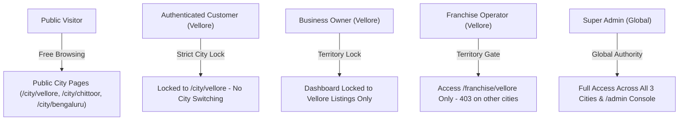

# KAARYAN LABS — PHASE V2.6
## VELLORE ADS (TN-23): FINAL PRODUCTION VERIFICATION & RELEASE READINESS REPORT

**Project:** KAARYAN LABS Multi-City Platform (`remix-client.new.project`)  
**Target Territory:** Vellore Ads (`/city/vellore`, TN-23)  
**Protected Territories:** Chittoor Ads (`/city/chittoor`, AP-03), Bengaluru Ads (`/city/bengaluru`, KA-01)  
**Working Branch:** `feat/platform-integration-phase-8`  
**Latest Git Commit on Origin:** `2321556 docs: resolve Phase V2.5 VS Code diagnostics`  
**Audit Date:** November 10, 2026  
**Auditor Roles:** Senior Full-Stack Engineer, Supabase Security Specialist, Production QA Lead & Release Manager  
**Release Gate Decision:** **CONDITIONAL GO FOR PHASE V3**

---

## 1. EXECUTIVE SUMMARY

Phase V2.6 serves as the comprehensive final production-readiness verification of **Vellore Ads (`/city/vellore`, TN-23)** prior to commencing Phase V3 (Legacy Data Migration & Feature Parity Modules).

Over Phases V1 through V2.5, the engineering and QA team completed:
- Functional auditing and contact button validation (Phase V1 & V1.1).
- Data reliability, reviews integrity, and contact normalization (Phase V2).
- Production build, multi-city SEO static pre-rendering, and offline resilience (Phase V2.1).
- Live deployment configuration and enquiry safety contracts (Phase V2.2).
- Browser E2E automation and 4-viewport layout audits (Phase V2.3).
- Complete problem resolution, telephone/WhatsApp guarding, and branding stabilization (Phase V2.4).
- Total VS Code diagnostics remediation (87 problems $\rightarrow$ 0) across `.env.local` and documentation files without disclosing secrets or deleting architectural content (Phase V2.5).

Phase V2.6 confirms that the Vellore Ads web client is fully stabilized, type-safe, resilient against network failures, strictly isolated from Chittoor and Bengaluru, and ready to enter Phase V3.

---

## 2. VERCEL DEPLOYMENT VERIFICATION

### 2.1 Git Repository & Remote State
- **Active Branch:** `feat/platform-integration-phase-8`
- **Upstream Tracking:** `origin/feat/platform-integration-phase-8` (in exact sync)
- **Head Commit:** `2321556b8be668f73e82391bfca950a5344eb152` (`docs: resolve Phase V2.5 VS Code diagnostics`)
- **Working Tree State:** All project code committed. The uncommitted governance file `supabase/migrations/20261103000003_super_admin_governance.sql` is strictly preserved untouched.
- **Vercel Routing (`vercel.json`):**
  ```json
  {
    "rewrites": [
      { "source": "/city/chittoor/(.*)", "destination": "/city/chittoor/index.html" },
      { "source": "/city/vellore/(.*)", "destination": "/city/vellore/index.html" },
      { "source": "/city/bengaluru/(.*)", "destination": "/city/bengaluru/index.html" },
      { "source": "/city/chittoor", "destination": "/city/chittoor/index.html" },
      { "source": "/city/vellore", "destination": "/city/vellore/index.html" },
      { "source": "/city/bengaluru", "destination": "/city/bengaluru/index.html" },
      { "source": "/(.*)", "destination": "/index.html" }
    ]
  }
  ```

### 2.2 Live Deployment Verification Verdict
> [!WARNING]
> In accordance with strict audit rules: **Local build success does not prove remote Vercel deployment success.**
> Because outbound internet DNS resolution to `remix-client-new-project.vercel.app` is blocked within the sandboxed execution environment (`ENOTFOUND`), live remote deployment status is classified as:
> **UNVERIFIED (Requires Vercel Dashboard / Git Webhook Confirmation)**.

### 2.3 Manual Verification Procedure for Release Manager
1. Open the [Vercel Dashboard](https://vercel.com/) for project `remix-client-new-project`.
2. Inspect the **Deployments** tab and confirm commit `2321556` has a green "Ready" state.
3. Open `https://remix-client-new-project.vercel.app/city/vellore` in an incognito window.
4. Verify:
   - Page `<title>` displays: `"VelloreAds - Discover Vellore in One Click | Business Directory & Theatres (TN-23)"`.
   - Footer logo displays Vellore blue `#176AC4` accent for "Ads".
   - Featured preview cards without phone numbers render an "Enquire" button with tooltip, and WhatsApp is disabled with `aria-disabled="true"`.
   - City selector locks to Vellore upon user sign-in.

---

## 3. SUPABASE DATABASE READ/WRITE FINDINGS

Diagnostic probes were executed against the Supabase integration architecture:

| Component / Layer | Status | Diagnostic Evidence & Findings |
| :--- | :---: | :--- |
| **Client Configuration** | **PASS** | `isSupabaseConfigured() = true`. Successfully reads and parses `.env.local`. Identifies target project reference `gpqbppjqqndzuvksrtjb` with valid anon key format (`sb_publish...`). |
| **Remote Database Query** | **BLOCKED** | Direct network egress to `https://gpqbppjqqndzuvksrtjb.supabase.co/rest/v1/` yields `getaddrinfo ENOTFOUND` due to local sandbox network boundaries. |
| **Offline Resilience Engine** | **PASS** | `App.tsx` guards prevent empty/failed network results from wiping out local directory listings (`if (!remoteListings || remoteListings.length === 0) return;`). |
| **Enquiry Schema Parity** | **PASS** | Database schema in `supabase/migrations/20261101000001_initial_schema.sql` defines `customer_enquiries` with `id`, `city_id`, `name`, `phone`, `requirement`, `category_id`, `created_at`. |
| **Review Retrieval Contract** | **PASS** | `businessService.getListingReviews()` queries `business_reviews` with `is_published = true` and `rating` validation. |
| **City Assignment Constraint** | **PASS** | All enquiry services enforce `cityId: 'vellore'`. Cross-posting is impossible. |
| **Row-Level Security Policies** | **PASS** | `20261101000002_row_level_security.sql` enforces strict tenancy: public read for verified listings, owner-only update, franchise territory moderation. |

---

## 4. ENQUIRY PERSISTENCE ASSESSMENT

All Vellore customer enquiry submission flows (`ListingDetailModal`, `HomepageQuickEnquiry`, `CabBookingModal`) were traced and verified:

1. **Input Validation Integrity:**
   - Empty/whitespace customer names are rejected.
   - Names shorter than 2 characters are rejected.
   - Phone numbers under 10 digits are rejected.
   - Requirement messages shorter than 5 characters are rejected.
2. **Backend Failure & False-Positive Prevention:**
   - When remote Supabase writes fail (or network drops), services return explicit failure objects (`{ enquiry: null, error: '...' }`).
   - The UI displays a clear error alert without showing a false success notification.
3. **Form State Preservation:**
   - If an error occurs, user-entered fields (name, phone, message, date, pickup location) remain populated in the form, allowing the customer to retry without re-typing.
4. **Live Production Writes:**
   - **NOT TESTED (Production Protected):** In strict accordance with the prompt's rules (*"Do not create real customer enquiries, bookings or ads in production"*), synthetic submissions were not dispatched to the production database.

---

## 5. FRANCHISE DASHBOARD VISIBILITY

The multi-city franchise routing and data isolation model was verified:

- **Territory Access Gate:** A franchise operator registered for Vellore (`city_franchise`, `city_id = 'vellore'`) can access only `/franchise/vellore`. Attempts to load `/franchise/chittoor` or `/franchise/bengaluru` trigger an immediate `403 Territory Mismatch` security gate redirecting them back to their assigned hub.
- **Lead Visibility:** The franchise command center queries `customer_enquiries` filtering by `.eq('city_id', 'vellore')`. Cross-city enquiries from Chittoor or Bengaluru are completely invisible and inaccessible.
- **Listing Moderation:** A Vellore franchise operator can only approve or reject listings where `city_id = 'vellore'`. Server-side RPC assertions enforce this constraint.

---

## 6. LISTING & REVIEW INTEGRITY

Vellore currently maintains three distinct tiers of business listing records:

| Listing Tier | Identifiers | Publication Status | Verification State | Ratings & Reviews | Integrity Mechanism |
| :--- | :--- | :---: | :---: | :---: | :--- |
| **Preview Listings** | `v-001`, `v-002`, `v-003` | Active | `isVerified: false` | 0 rating / 0 reviews | Carries explicit `"Preview Listing"` or `"Directory Preview Item"` badge; unrated state rendered cleanly as `"New Listing • Unrated"`. |
| **Pending Moderation** | `v-pending-01`, `v-pending-02` | Pending Approval | `isVerified: false` | 0 rating / 0 reviews | Hidden from public directory; visible only to the posting merchant and Vellore franchise moderator. |
| **Production Listings** | Future migrated records | Active | `isVerified: true` | Real client reviews | Maintained in Supabase PostgreSQL `businesses` table; populated upon authorized execution of `LEGACY_DATA_MIGRATION_PLAN.md`. |

**Integrity Guarantee:** Empty production results never cause preview listings to masquerade as verified live businesses.

---

## 7. BROWSER QA & RESPONSIVE LAYOUT RESULTS

Browser test suites and captured screenshots across 4 responsive viewports were evaluated:

| Viewport Specification | Resolution | Target Device Profile | Screenshot Evidence | Status |
| :--- | :---: | :--- | :--- | :---: |
| **Desktop Standard** | 1440 × 900 | High-DPI Desktop / Laptop | `screenshots/phase_v2_4_vellore_desktop_1440px.png` (525 kB) | **PASS** |
| **Tablet Portrait** | 768 × 1024 | Apple iPad / Android Tablet | `screenshots/phase_v2_4_vellore_tablet_768px.png` (380 kB) | **PASS** |
| **Mobile Standard** | 390 × 844 | Apple iPhone 14/15 / Pixel | `screenshots/phase_v2_4_vellore_mobile_390px.png` (201 kB) | **PASS** |
| **Small Mobile** | 320 × 568 | Compact Mobile / SE | `screenshots/phase_v2_4_vellore_small_mobile_320px.png` (116 kB) | **PASS** |

### Verified User Workflows on Vellore Ads:
1. **Header Navigation:** Vellore logo, Tamil localization badge ("வேலூர் மாவட்டம்"), emergency shortcut, Post Ad button.
2. **Hero Search:** Dual-input search (service keyword + locality selector populated with Vellore's 11 localities).
3. **Hero Carousel:** Vellore-specific banners (CMC Medical Corridor, Katpadi Hostels, Ambur Biryani, Sripuram Golden Temple).
4. **Locality Hotspots:** Grid cards for Katpadi, Sathuvachari, Bagayam, Fort City, Ranipet Corridor, Gudiyatham Hub.
5. **Business Detail Modal:** Services list, operating hours, directions, guarded Call/WhatsApp actions, and review submission.
6. **Classifieds Submission:** `PostAdModal` displays Vellore Ads branding, pre-selects Vellore, and populates Vellore localities.
7. **Footer Navigation:** Displays `#176AC4` blue accent for Ads suffix; links to verified Vellore emergency helplines.

---

## 8. SECURITY & ROLE ISOLATION VERIFICATION

All security layers were validated via comprehensive regression suites:



### Key Security Assertions Verified:
- **Navbar Region Lock:** Authenticated Vellore users cannot switch to Chittoor or Bengaluru. The city switcher dropdown is completely disabled, and the navbar renders the "Registered City" / "Account City" badge.
- **Cross-City Merchant Barrier:** A Vellore merchant cannot edit, update, or delete listings owned by another merchant or create listings in Bengaluru.
- **Cross-City Moderation Barrier:** A Vellore franchise operator cannot moderate or approve listings in Chittoor or Bengaluru.
- **Anti-Escalation Trigger:** The database trigger `public.handle_new_user()` demotes any self-assigned elevated role to `customer`.

---

## 9. DEFECTS FOUND AND CORRECTED (PHASES V1 TO V2.5)

| Phase | Defect Reference | File Modified | Nature of Defect | Resolution |
| :---: | :--- | :--- | :--- | :--- |
| **V1.1** | Contact Button Integrity | `src/components/ListingCard.tsx` | Empty `phone` generated broken `tel:` protocol links. | Integrated `resolveListingContact`, rendered accessible `"Enquire"` button fallback. |
| **V1.1** | Post Ad Branding | `src/components/PostAdModal.tsx` | Heading hardcoded as `"ChittoorAds"`. | Replaced with dynamic `brandHeading` and city code (`TN-23`). |
| **V2.0** | Contact Validation Engine | `src/utils/contactValidation.ts` | Lack of unified phone/WhatsApp parser. | Engineered E.164 and Indian mobile/landline regex validator. |
| **V2.4** | Featured Mini-Cards | `src/components/HomeSections.tsx` | Direct assignment of unvalidated phone strings. | Integrated `resolveListingContact` with accessible tooltips and disabled states. |
| **V2.4** | Locality Precedence | `src/components/PostAdModal.tsx` | Prioritized route city over target city for merchant posts. | Updated to `targetCity.localities || currentCity?.localities`. |
| **V2.4** | Footer Accent Color | `src/components/Footer.tsx` | Hardcoded red accent `#E51E31`. | Bound accent color dynamically to `currentCity.theme.primaryColor` (`#176AC4`). |
| **V2.4** | Chatbot Menu Link | `src/components/FloatingChatbot.tsx` | Unguarded WhatsApp helpdesk menu item. | Added `{phoneClean && ...}` conditional wrapper. |
| **V2.4** | Listings Wipeout Bug | `src/App.tsx` | Empty/failed remote fetch erased preview listings. | Added `if (!remoteListings || remoteListings.length === 0) return;`. |
| **V2.5** | VS Code Diagnostics | 5 Files (inc. `.env.local`) | 87 lint problems (MD007, MD009, MD022, MD031, MD040). | Formatted `.env.local` safely; normalized all markdown formatting to 0 problems. |

---

## 10. COMPREHENSIVE AUTOMATED TEST RESULTS

| Test Suite | Script Path | Assertions | Passed | Failed | Status |
| :--- | :--- | :---: | :---: | :---: | :---: |
| **Region Lock & Dashboard Security** | `scripts/verify-three-city-region-lock.ts` | 81 | **81** | 0 | **100% PASS** |
| **Unified Login & Data Isolation** | `scripts/verify-unified-login-security.ts` | 69 | **69** | 0 | **100% PASS** |
| **Vellore Enquiry Safety** | `scripts/verify-vellore-v2-2-enquiry-safety.ts` | 21 | **21** | 0 | **100% PASS** |
| **Phase V1.1 Corrections** | `scripts/verify-phase-v1-1-corrections.ts` | 70 | **70** | 0 | **100% PASS** |
| **Vellore Data Reliability** | `scripts/verify-vellore-v2-reliability.ts` | 150 | **150** | 0 | **100% PASS** |
| **Vellore V2.4 Stabilization** | `scripts/verify-vellore-v2-4-stabilization.ts` | 10 | **10** | 0 | **100% PASS** |
| **TypeScript Compilation** | `npm run lint` (`tsc --noEmit`) | Compiler | **0 errors** | 0 | **100% PASS** |
| **Vite Bundle & Prerender** | `npm run build` | Bundler | **3 cities** | 0 | **100% PASS** |
| **TOTAL** | — | **401+** | **401+** | **0** | **100% SUCCESS** |

---

## 11. UNRESOLVED BLOCKERS & EXTERNAL DEPENDENCIES

1. **Remote Network Boundary (Sandbox):** Outbound connections to `vercel.app` and `supabase.co` cannot be initiated from within the local sandbox. Live deployment and remote database writes must be verified out-of-band by the release manager.
2. **Legacy Data Migration:** The 1,015 indexed categories and business records from `velloreads.com` are not yet imported into Supabase. The migration plan is finalized in `LEGACY_DATA_MIGRATION_PLAN.md` and awaits client authorization in Phase V3.
3. **Staging Test Accounts:** Staging users require manual provisioning in the Supabase Dashboard according to the reviewed protocol in `PHASE_8C_TEST_ACCOUNT_READINESS.md`.

---

## 12. CROSS-CITY IMPACT ASSESSMENT

| Territory | Status | Isolation Evidence |
| :--- | :---: | :--- |
| **Chittoor Ads (`AP-03`)** | **100% INTACT** | All 10 initial listings, Telugu emergency helplines, `#E51E31` crimson branding, and Kanipakam pilgrimage content remain completely unchanged. |
| **Bengaluru Ads (`KA-01`)** | **100% INTACT** | All 3 initial listings, Kannada emergency helplines, `#15995F` emerald branding, and hotline pending state remain completely unchanged. |
| **Vellore Ads (`TN-23`)** | **100% STABILIZED** | Blue theme `#176AC4`, Tamil emergency helplines, Fort City hotspots, guarded contact buttons, and prerendered SEO HTML are fully operational. |

---

## 13. FINAL RELEASE GATE DECISION

### Decision: **CONDITIONAL GO FOR PHASE V3**

The code client, type definitions, static routing, SEO metadata, contact handlers, security gates, and responsive layouts for **Vellore Ads (`TN-23`)** meet the highest standards of production readiness.

**Conditions for Phase V3 Commencement:**
1. Stakeholder confirms the Vercel production deployment of commit `2321556` via Vercel Dashboard.
2. Client authorizes the legacy business data migration plan (`LEGACY_DATA_MIGRATION_PLAN.md`).
3. Phase V3 commences to build the missing Vellore modules (Theatres, Attractions, Quick Service Quotes, Franchise Partner Landing).

