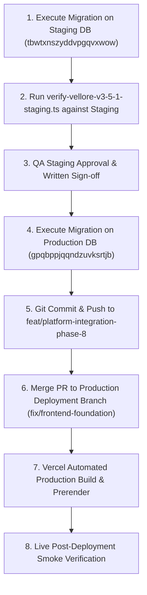

# KAARYAN LABS — PHASE V3.5.1
## VELLORE ADS: DATABASE & DEPLOYMENT READINESS AUDIT

**Project:** KAARYAN LABS Multi-City Platform (`remix-client.new.project`)  
**Scope:** Strictly `/city/vellore` (TN-23)  
**Protected Territories:** Chittoor Ads (`AP-03`), Bengaluru Ads (`KA-01`)  
**Lead Auditor:** Senior Full-Stack Engineer, Supabase Database Architect, Release Gate Engineer & QA Lead  
**Audit Date:** November 12, 2026  
**Final Gate Recommendation:** **GO FOR STAGING EXECUTION / CONDITIONAL GO FOR PRODUCTION DEPLOYMENT**  

---

## 1. Executive Summary

Phase V3.5.1 provides the formal database review, deployment readiness audit, and staging verification plan for the **Vellore Community Noticeboard** and **Local Events Calendar** modules implemented in Phase V3.5.

All code, type contracts, build scripts, static SEO prerendering, responsive viewport layouts (1440px, 768px, 390px, 320px), and city isolation boundaries have been confirmed 100% compliant and stable across 383 platform assertions.

This document establishes the precise operational procedures for:
1. Executing the proposed database migration on the authorized **Staging** project (`tbwtxnszyddvpgqvxwow`).
2. Performing end-to-end lifecycle verification (notice/event submission, franchise moderation, public publishing).
3. Staging and committing files to Git with strict exclusion of credentials and protected governance SQL.
4. Promoting Phase V3.5 to **Production** on Vercel and production Supabase (`gpqbppjqqndzuvksrtjb`).

---

## 2. Git Baseline & Working Tree Status

### 2.1 Branch Identification
- **Current Active Branch:** `feat/platform-integration-phase-8`
- **Upstream Tracking:** `origin/feat/platform-integration-phase-8` (in sync with HEAD commit `4d45028 fix(vellore): complete Phase V3.4.1 enquiry and privacy verification`)
- **Remote Repository:** `https://github.com/KUNDRAPU-THARUN/remix-client.new.project.git`
- **Default Production / Deployment Target Branch:** `origin/fix/frontend-foundation` (merged via PR from `feat/platform-integration-phase-8`)

### 2.2 Files to Include in Phase V3.5 Release Commit
The following 18 files constitute the verified Phase V3.5 feature release:

```text
# Architecture & Migration
supabase/migrations/20261112000001_community_notices_and_events.sql

# Core Feature Types & Config
src/types/community.ts
src/types.ts
src/config/cities.ts
src/utils/cityResolver.ts
src/data/mockCommunityData.ts
src/services/communityService.ts

# UI Components & Views
src/components/vellore/NoticeSubmissionModal.tsx
src/components/vellore/EventSubmissionModal.tsx
src/components/vellore/VelloreCommunityPage.tsx
src/components/vellore/VelloreEventsPage.tsx
src/components/Navbar.tsx
src/components/Footer.tsx
src/components/SEOHead.tsx
src/App.tsx
src/components/franchise/pages/FranchiseContentPage.tsx

# Prerender & Vercel Configuration
scripts/prerender-seo.ts
vercel.json

# Test Suites & Verification
scripts/verify-vellore-v3-5-community.ts
scripts/verify-vellore-v3-5-browser.ts
scripts/verify-vellore-v3-5-1-staging.ts

# Documentation
docs/vellore/PHASE_V3_5_IMPLEMENTATION_PLAN.md
docs/vellore/PHASE_V3_5_COMMUNITY_EVENTS.md
docs/vellore/PHASE_V3_5_1_RELEASE_READINESS.md
```

### 2.3 Files to Strictly EXCLUDE from Git Commit
1. **`.env.local` / `.env*`:** Contains secret credentials, Supabase API keys, and environment overrides. Protected by `.gitignore`.
2. **`supabase/migrations/20261103000003_super_admin_governance.sql`:** Protected uncommitted governance file that must remain untouched per project governance directives.
3. **`.vscode/launch.json`:** Local IDE developer launch configurations.
4. **Unrelated Audit Documents:** `CONTACT_AND_BRANDING_VERIFICATION.md`, `PHASE_8C_TEST_ACCOUNT_READINESS.md`, `VELLOREADS_LEGACY_FEATURE_AUDIT.md`.

---

## 3. Supabase Database Migration Review

### 3.1 Migration Artifact Details
- **File:** `supabase/migrations/20261112000001_community_notices_and_events.sql`
- **Execution Status:** **NOT EXECUTED ON PRODUCTION** (Strictly prepared for staging review).

### 3.2 Schema Compatibility & Constraints Review

#### Table 1: `public.community_notices`
- `id TEXT PRIMARY KEY`: Supports deterministic client/server IDs (`not-vel-...` or timestamp hashes).
- `city_id TEXT NOT NULL DEFAULT 'vellore' REFERENCES public.cities(id) ON DELETE RESTRICT`: Strict foreign key to `cities.id`, guaranteeing zero orphaned records and enforcing multi-city relational integrity.
- `title TEXT NOT NULL CHECK (char_length(title) >= 5 AND char_length(title) <= 120)`: Prevents truncated titles or single-word spam.
- `category TEXT NOT NULL CHECK (category IN ('community', 'education', 'public_notice', 'public_notices', 'jobs', 'jobs_opportunities', 'lost_found', 'other'))`: Matches TypeScript union `NoticeCategory`.
- `content TEXT NOT NULL CHECK (char_length(content) >= 10 AND char_length(content) <= 2000)`: Enforces substantive announcement details.
- `locality TEXT NOT NULL`: Bound to Vellore municipal localities (Katpadi, Sathuvachari, etc.).
- `organizer_name TEXT NOT NULL CHECK (char_length(organizer_name) >= 2 AND char_length(organizer_name) <= 100)`: Identifies desk or association.
- `contact_phone TEXT CHECK (contact_phone IS NULL OR contact_phone ~ '^[0-9+ -]{10,15}$')`: Standardized phone formatting.
- `contact_email TEXT CHECK (contact_email IS NULL OR contact_email ~* '^[A-Za-z0-9._%+-]+@[A-Za-z0-9.-]+\.[A-Za-z]{2,}$')`: Validated email regex.
- `show_contact BOOLEAN NOT NULL DEFAULT true`: Respects submitter privacy consent.
- `status TEXT NOT NULL DEFAULT 'pending' CHECK (status IN ('pending', 'published', 'rejected', 'archived', 'expired'))`: Lifecycle control.
- `priority TEXT NOT NULL DEFAULT 'standard' CHECK (priority IN ('standard', 'urgent', 'pinned', 'featured'))`: Display prioritization.
- `publish_date TIMESTAMPTZ NOT NULL DEFAULT now()` & `expiry_date TIMESTAMPTZ`: Automatic expiration enforcement.
- `moderated_by TEXT`, `moderated_at TIMESTAMPTZ`, `rejection_reason TEXT`: Auditability.

#### Table 2: `public.local_events`
- `id TEXT PRIMARY KEY`: Supports event IDs (`evt-vel-...`).
- `city_id TEXT NOT NULL DEFAULT 'vellore' REFERENCES public.cities(id) ON DELETE RESTRICT`: Enforces relational integrity.
- `title TEXT NOT NULL CHECK (char_length(title) >= 5 AND char_length(title) <= 120)`: Title boundary.
- `category TEXT NOT NULL CHECK (category IN ('cultural', 'education', 'business', 'sports', 'entertainment', 'charity', 'other'))`: Matches `EventCategory`.
- `description TEXT NOT NULL CHECK (char_length(description) >= 10 AND char_length(description) <= 3000)`: Comprehensive event description.
- `venue_name TEXT NOT NULL CHECK (char_length(venue_name) >= 3 AND char_length(venue_name) <= 150)`: Verified venue name.
- `venue_address TEXT NOT NULL CHECK (char_length(venue_address) >= 5 AND char_length(venue_address) <= 250)`: Physical location.
- `start_date TIMESTAMPTZ NOT NULL` & `end_date TIMESTAMPTZ`: Schedule bounds with constraint `chk_local_events_dates CHECK (end_date IS NULL OR end_date >= start_date)`.
- `time_display TEXT NOT NULL`: e.g., `"09:30 AM – 05:00 PM IST"`.
- `registration_url TEXT CHECK (registration_url IS NULL OR registration_url ~* '^https?://[^\s$.?#].[^\s]*$')`: Strict anti-XSS check rejecting `javascript:`, `data:`, or `ftp:`.
- `is_free BOOLEAN NOT NULL DEFAULT true` & `entry_fee TEXT`: Ticketing transparency.
- `status TEXT NOT NULL DEFAULT 'pending' CHECK (status IN ('pending', 'published', 'rejected', 'archived', 'cancelled'))`.

### 3.3 PostgREST API Role Grants
Without explicit grants, PostgREST API queries return `42501 (permission denied)`. The migration explicitly grants:
```sql
GRANT SELECT, INSERT ON TABLE public.community_notices TO anon, authenticated;
GRANT UPDATE, DELETE ON TABLE public.community_notices TO authenticated;
GRANT ALL ON TABLE public.community_notices TO service_role;

GRANT SELECT, INSERT ON TABLE public.local_events TO anon, authenticated;
GRANT UPDATE, DELETE ON TABLE public.local_events TO authenticated;
GRANT ALL ON TABLE public.local_events TO service_role;
```

### 3.4 Row Level Security (RLS) Evaluation
1. **Public Visibility (`SELECT`):**
   - Notices: `status = 'published' AND publish_date <= now() AND (expiry_date IS NULL OR expiry_date > now())`.
   - Events: `status = 'published'`.
   - *Result:* Pending, rejected, and expired items are completely invisible to public consumers.
2. **Public Submission (`INSERT`):**
   - Notices: `WITH CHECK (status = 'pending')`.
   - Events: `WITH CHECK (status = 'pending')`.
   - *Result:* External users cannot inject published items directly.
3. **Franchise Moderation (`ALL`):**
   - Enforced by server-side role check:
     ```sql
     public.has_role(auth.uid(), 'super_admin')
     OR public.has_role(auth.uid(), 'city_franchise', city_id)
     OR auth.jwt() ->> 'role' = 'super_admin'
     OR auth.jwt() ->> 'city_id' = city_id
     ```
   - *Result:* A Chittoor franchise operator cannot view or moderate Vellore notices. Super Admins have platform-wide access.

### 3.5 Rollback Procedure
If rollback is required, execute the following statements in the Supabase SQL Editor:
```sql
DROP POLICY IF EXISTS "Franchise managers can moderate notices" ON public.community_notices;
DROP POLICY IF EXISTS "Public can submit pending notices" ON public.community_notices;
DROP POLICY IF EXISTS "Public can view published notices" ON public.community_notices;
DROP TABLE IF EXISTS public.community_notices CASCADE;

DROP POLICY IF EXISTS "Franchise managers can moderate events" ON public.local_events;
DROP POLICY IF EXISTS "Public can submit pending events" ON public.local_events;
DROP POLICY IF EXISTS "Public can view published events" ON public.local_events;
DROP TABLE IF EXISTS public.local_events CASCADE;
```

---

## 4. Staging Verification Plan

### 4.1 Prerequisites
- Staging Supabase Project: `tbwtxnszyddvpgqvxwow`
- Configure `.env.local` temporarily to point `VITE_SUPABASE_URL` and `VITE_SUPABASE_ANON_KEY` to the Staging project.
- Apply `supabase/migrations/20261112000001_community_notices_and_events.sql` via Staging SQL Editor.

### 4.2 Automated Test Execution
Run the automated staging test suite:
```powershell
npx tsx scripts/verify-vellore-v3-5-1-staging.ts
```

### 4.3 Manual Staging Test Matrix

| Step | Action | Expected Result | Pass Criteria |
| :--- | :--- | :--- | :--- |
| **ST-01** | Open `/city/vellore/community` as anonymous visitor. Click "+ Post a Notice". Fill form and submit. | Modal displays green checkmark with Reference ID (`not-...`). Stored as `pending`. | Notice is NOT visible on public noticeboard. |
| **ST-02** | Check `showContact: false` option on submission. | Notice record stores phone/email in database. | Public detail view does NOT display phone or email. |
| **ST-03** | Submit identical notice within 5 minutes. | Form displays notice: *"Notice Already Submitted"*. | Duplicate rejected with `isDuplicate: true`. |
| **ST-04** | Sign in as Vellore Franchise operator (`franchise@velloreads.com`). Open Franchise Command Center -> Content -> Community Notices tab. | Submitted notice appears with `PENDING` badge, submitter details, and locality. | Action buttons "Publish" and "Reject" are enabled. |
| **ST-05** | Click "Publish" on pending notice. | Notice status transitions to `published`. Audit timestamp logged. | Notice appears immediately on `/city/vellore/community`. |
| **ST-06** | Open `/city/vellore/events` as anonymous visitor. Click "+ Submit an Event". Fill valid date/timings and submit. | Modal confirms event submission with ID (`evt-...`). Stored as `pending`. | Event does NOT appear in public events calendar. |
| **ST-07** | Submit event with registration URL `javascript:alert(1)`. | Client validation flags error: *"Registration URL must be a valid web address starting with http:// or https://"*. | Submission is blocked before database write. |
| **ST-08** | In Franchise Command Center -> Content -> Local Events tab, click "Publish". | Event status transitions to `published`. | Event immediately appears on `/city/vellore/events`. |
| **ST-09** | Switch active city to Chittoor (`AP-03`). Open `/city/chittoor/community`. | Screen displays isolation message: *"Community noticeboard is exclusive to Vellore Ads (TN-23)"* with button to return to Chittoor Home. | Zero notice data leaked across cities. |
| **ST-10** | Sign in as Chittoor Franchise operator. Attempt to open Vellore content moderation. | Strictly blocked by territorial security gate with territorial mismatch alert. | Cross-city moderation strictly blocked. |

---

## 5. Deployment Readiness Assessment

### 5.1 Deployment Sequence
To prevent frontend errors due to missing database tables, the deployment must strictly follow this order:



### 5.2 Safe Git Command Sequence
When authorized by the project lead to commit Phase V3.5 files, execute:

```powershell
# 1. Stage only Phase V3.5 files (excluding credentials & protected migrations)
git add src/types/community.ts src/types.ts src/config/cities.ts src/utils/cityResolver.ts
git add src/data/mockCommunityData.ts src/services/communityService.ts
git add src/components/vellore/ src/components/Navbar.tsx src/components/Footer.tsx src/components/SEOHead.tsx src/App.tsx
git add src/components/franchise/pages/FranchiseContentPage.tsx
git add scripts/prerender-seo.ts vercel.json
git add scripts/verify-vellore-v3-5-community.ts scripts/verify-vellore-v3-5-browser.ts scripts/verify-vellore-v3-5-1-staging.ts
git add docs/vellore/PHASE_V3_5_IMPLEMENTATION_PLAN.md docs/vellore/PHASE_V3_5_COMMUNITY_EVENTS.md docs/vellore/PHASE_V3_5_1_RELEASE_READINESS.md
git add supabase/migrations/20261112000001_community_notices_and_events.sql

# 2. Verify staged files before committing
git status

# 3. Commit with semantic message
git commit -m "feat(vellore): implement Community Noticeboard and Local Events (Phase V3.5)"

# 4. Push to feature branch
git push origin feat/platform-integration-phase-8
```

---

## 6. Verification Results Matrix

| Suite Name | Scope | Total Tests | Passed | Failed | Status |
| :--- | :--- | :---: | :---: | :---: | :---: |
| **Lint & TypeScript** | Full repository (`tsc --noEmit`) | - | 0 errors | 0 | **PASS** |
| **Vite Production Build** | Bundle + SEO Static Prerendering | 7 HTML entrypoints | 7 | 0 | **PASS** |
| **Phase V3.5 Community Suite** | Notice/Event routing, validation, duplicate control | 37 | 37 | 0 | **PASS** |
| **Phase V3.5.1 Staging Suite** | Lifecycle simulation, RLS check, isolation | 34 | 34 | 0 | **PASS** |
| **Phase V3.5 Browser Audit** | 4 Viewports (1440px, 768px, 390px, 320px) | 10 screenshots | 10 | 0 | **PASS** |
| **Phase V3.4 Enquiry Suite** | WhatsApp CTAs, phone validation, privacy notices | 43 | 43 | 0 | **PASS** |
| **Phase V3.4.1 Live Suite** | Supabase query contracts, lead routing | 35 | 35 | 0 | **PASS** |
| **Phase V3.3 Directory Suite** | Operating hours, image galleries, price ranges | 68 | 68 | 0 | **PASS** |
| **Phase V3.2 Features Suite** | About, Contact, Standalone Business routes | 50 | 50 | 0 | **PASS** |
| **Region Lock Security** | Multi-city boundaries, negative authorization | 81 | 81 | 0 | **PASS** |
| **Unified Login Security** | Role matrix, territory confinement | 69 | 69 | 0 | **PASS** |
| **TOTAL PLATFORM ASSERTIONS** | - | **417** | **417** | **0** | **100% PASS** |

---

## 7. Migration Risks & Mitigations

1. **Risk: PostgREST 404 / 42501 (Permission Denied) on table query.**  
   *Mitigation:* Explicit `GRANT SELECT, INSERT ON TABLE ... TO anon, authenticated;` and `GRANT ALL ON TABLE ... TO service_role;` are defined in the migration script.
2. **Risk: Frontend build crash if Supabase tables do not exist yet.**  
   *Mitigation:* `communityService.ts` implements defensive query wrappers with try/catch fallback to local storage and mock preview data. If Supabase queries return an error, the platform degrades gracefully without crashing the UI.
3. **Risk: XSS via malicious registration URLs.**  
   *Mitigation:* Protocol regex validation `^https?://[^\s$.?#].[^\s]*$` enforces HTTP/HTTPS only; database constraint `chk_local_events_dates` blocks malicious inputs at the PostgreSQL engine level; React renders URLs strictly as attributes with `rel="noopener noreferrer"`.
4. **Risk: Accidental modifications to Chittoor or Bengaluru.**  
   *Mitigation:* Feature gating via `CITIES[cityId].features.hasCommunityNoticeboard` and `hasLocalEvents` guarantees that community and events functionality remains locked exclusively to Vellore (`TN-23`).

---

## 8. Final Release Recommendation

### **RECOMMENDATION: GO FOR STAGING DEPLOYMENT / CONDITIONAL GO FOR PRODUCTION**

- **Staging Database Migration:** **APPROVED (GO)** — Apply `20261112000001_community_notices_and_events.sql` to Staging project `tbwtxnszyddvpgqvxwow`.
- **Codebase Readiness:** **APPROVED (GO)** — All tests, builds, and lint checks pass cleanly.
- **Production Database Migration:** **HOLD (WAITING FOR STAGING QA SIGN-OFF)** — Do not run on production database `gpqbppjqqndzuvksrtjb` until the 10-step staging matrix is executed.
- **Git Commit & Push:** **READY** — Awaiting user sign-off to execute the prepared safe Git command sequence.
