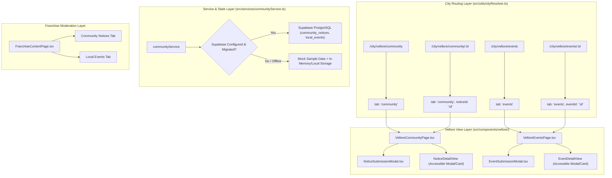

# KAARYAN LABS — PHASE V3.5 IMPLEMENTATION PLAN
## VELLORE ADS (TN-23): COMMUNITY NOTICEBOARD & LOCAL EVENTS

**Author:** Senior Full-Stack React/TypeScript Architect, Supabase Security Specialist & Production QA Lead  
**Territory:** Vellore Ads (`/city/vellore`, TN-23)  
**Protected Territories:** Chittoor Ads (`/city/chittoor`, AP-03), Bengaluru Ads (`/city/bengaluru`, KA-01)  
**Target Branch:** `feat/platform-integration-phase-8`  
**Preserved Uncommitted File:** `supabase/migrations/20261103000003_super_admin_governance.sql` (Must remain untouched)  
**Status:** READY FOR EXECUTION  

---

### 1. Executive Mission & Scope Boundaries

Phase V3.5 implements a dedicated, production-quality **Community Noticeboard** (`/city/vellore/community`) and **Local Events Platform** (`/city/vellore/events`) exclusively for Vellore Ads (TN-23). 

#### Strict Scope Boundaries:
1. **Vellore-Only Enhancement:** All new community and event features, navigation links, filters, and moderation tools are active solely for `cityId === 'vellore'`.
2. **Strict Multi-City Isolation:** Chittoor Ads (`AP-03`) and Bengaluru Ads (`KA-01`) routing, navigation bars, footers, and dashboards remain 100% untouched and functional.
3. **No Unapproved Database Migrations:** A proposed SQL migration file will be prepared in `supabase/migrations/20261112000001_community_notices_and_events.sql` for review, but **will not be executed** against production.
4. **Honest Persistence & Demo Mode:** In offline, unconfigured, or pre-migration environments, client services will use in-memory and local mock persistence with clear "Preview / Demo Mode" status indicators. No fake server confirmation IDs or fictional delivery claims.
5. **No Fictional Real Data:** Sample preview notices and events will be clearly labeled as sample demonstration items, avoiding real organizer names, phone numbers, addresses, or dates.
6. **No Automatic Deployments:** Zero git commits, zero git pushes, zero Vercel deployments.

---

### 2. Architecture & Data Model

---

### 3. Data Schema & Proposed Migration Design

#### A. `public.community_notices`
- `id`: `UUID PRIMARY KEY DEFAULT gen_random_uuid()`
- `city_id`: `TEXT NOT NULL REFERENCES public.cities(id)` (Strictly 'vellore' in Phase V3.5)
- `title`: `TEXT NOT NULL` (5 to 100 characters)
- `category`: `TEXT NOT NULL CHECK (category IN ('community', 'education', 'public_notices', 'jobs_opportunities', 'lost_found', 'other'))`
- `description`: `TEXT NOT NULL` (10 to 2000 characters)
- `locality`: `TEXT` (Valid locality from Vellore localities list)
- `author_id`: `UUID REFERENCES auth.users(id)`
- `author_name`: `TEXT NOT NULL`
- `contact_phone`: `TEXT`
- `contact_email`: `TEXT`
- `show_contact`: `BOOLEAN NOT NULL DEFAULT false` (Consent guard)
- `status`: `TEXT NOT NULL DEFAULT 'pending' CHECK (status IN ('pending', 'published', 'rejected', 'expired'))`
- `priority`: `TEXT NOT NULL DEFAULT 'standard' CHECK (priority IN ('standard', 'featured', 'urgent'))`
- `rejection_reason`: `TEXT`
- `moderated_by`: `UUID REFERENCES auth.users(id)`
- `moderated_at`: `TIMESTAMPTZ`
- `published_at`: `TIMESTAMPTZ`
- `expires_at`: `TIMESTAMPTZ`
- `created_at`: `TIMESTAMPTZ DEFAULT now()`
- `updated_at`: `TIMESTAMPTZ DEFAULT now()`

#### B. `public.local_events`
- `id`: `UUID PRIMARY KEY DEFAULT gen_random_uuid()`
- `city_id`: `TEXT NOT NULL REFERENCES public.cities(id)`
- `title`: `TEXT NOT NULL` (5 to 100 characters)
- `category`: `TEXT NOT NULL CHECK (category IN ('cultural', 'education', 'business', 'sports', 'charity', 'entertainment', 'other'))`
- `description`: `TEXT NOT NULL` (10 to 2000 characters)
- `organizer`: `TEXT NOT NULL`
- `venue`: `TEXT NOT NULL`
- `locality`: `TEXT NOT NULL`
- `start_date`: `TIMESTAMPTZ NOT NULL` (Asia/Kolkata timezone compliant)
- `end_date`: `TIMESTAMPTZ NOT NULL`
- `price_type`: `TEXT NOT NULL DEFAULT 'free' CHECK (price_type IN ('free', 'paid', 'donation', 'invite_only'))`
- `price_amount`: `TEXT` (e.g. "₹150 Entry", "Free Registration")
- `registration_url`: `TEXT` (Validated `http://` or `https://` external URL)
- `poster_url`: `TEXT`
- `author_id`: `UUID REFERENCES auth.users(id)`
- `contact_phone`: `TEXT`
- `contact_email`: `TEXT`
- `show_contact`: `BOOLEAN NOT NULL DEFAULT false`
- `status`: `TEXT NOT NULL DEFAULT 'pending' CHECK (status IN ('pending', 'published', 'rejected', 'cancelled'))`
- `is_featured`: `BOOLEAN NOT NULL DEFAULT false`
- `rejection_reason`: `TEXT`
- `moderated_by`: `UUID REFERENCES auth.users(id)`
- `moderated_at`: `TIMESTAMPTZ`
- `created_at`: `TIMESTAMPTZ DEFAULT now()`
- `updated_at`: `TIMESTAMPTZ DEFAULT now()`

---

### 4. Inventory of Touched & New Files

#### New Files to Create:
1. `docs/vellore/PHASE_V3_5_IMPLEMENTATION_PLAN.md` (This architecture plan)
2. `supabase/migrations/20261112000001_community_notices_and_events.sql` (Proposed SQL schema & RLS rules; not run remotely)
3. `src/types/community.ts` (TypeScript interfaces, category definitions, and status enums)
4. `src/data/mockCommunityData.ts` (Sample clearly labeled preview notices and events for Vellore)
5. `src/services/communityService.ts` (Data fetching, client-side validation, duplicate prevention, and offline fallback)
6. `src/components/vellore/VelloreCommunityPage.tsx` (Noticeboard view with category tabs, search, empty states, detail modal)
7. `src/components/vellore/VelloreEventsPage.tsx` (Events view with upcoming/past toggle, date/locality filter, detail modal)
8. `src/components/vellore/NoticeSubmissionModal.tsx` (Accessible submission modal with consent guarding and validation)
9. `src/components/vellore/EventSubmissionModal.tsx` (Accessible event submission modal with URL/date validation)
10. `scripts/verify-vellore-v3-5-community.ts` (Automated verification suite with 40+ contract and unit assertions)
11. `docs/vellore/PHASE_V3_5_COMMUNITY_EVENTS.md` (Final documentation report)

#### Existing Files to Modify (Carefully Scoped):
1. `src/types.ts`:
   - Extend `CityConfig['features']` with optional `hasCommunityNoticeboard?: boolean` and `hasLocalEvents?: boolean`.
2. `src/config/cities.ts`:
   - Enable `hasCommunityNoticeboard: true` and `hasLocalEvents: true` on `CITIES.vellore`.
   - Preserve `hasCommunityNoticeboard: false` and `hasLocalEvents: false` on `CITIES.chittoor` and `CITIES.bengaluru`.
3. `src/utils/cityResolver.ts`:
   - Add `'community'` and `'events'` to `ParsedCityRoute['tab']`.
   - Match subpaths `/community`, `/community/:id`, `/events`, `/events/:id`.
   - Generate canonical URLs via `buildCityRouteUrl`.
4. `src/App.tsx`:
   - Add view render branches for `activeTab === 'community' && route.cityId === 'vellore'` and `activeTab === 'events' && route.cityId === 'vellore'`.
5. `src/components/Navbar.tsx`:
   - Conditionally render navigation links for "Community" and "Events" when `currentCity.features.hasCommunityNoticeboard` is true (Vellore only).
6. `src/components/Footer.tsx`:
   - Add Vellore-scoped links to Community Noticeboard and Local Events in the City Directory column.
7. `src/components/franchise/pages/FranchiseContentPage.tsx`:
   - Add subtabs for "Community Notices" and "Local Events" when viewing Vellore territory.
8. `scripts/prerender-seo.ts`:
   - Add static SEO prerender passes for `dist/city/vellore/community/index.html` and `dist/city/vellore/events/index.html`.
9. `vercel.json`:
   - Add rewrite mappings for `/city/vellore/community(.*)` and `/city/vellore/events(.*)` to their prerendered index files.

---

### 5. Risk Assessment & Mitigation Strategies

| Risk | Likelihood | Impact | Mitigation Strategy |
| :--- | :---: | :---: | :--- |
| **Cross-City Pollution:** Community or Events showing on Chittoor/Bengaluru. | Low | High | Feature-flagged via `currentCity.features.hasCommunityNoticeboard` and `hasLocalEvents`. Strict route guard `route.cityId === 'vellore'`. Tested in regression suite. |
| **XSS via User Submissions:** Malicious script injection in notice or event text. | Low | Critical | React escapes all JSX text by default. Zero `dangerouslySetInnerHTML`. URL validation rejects non-HTTP(S) protocols (`javascript:`, `data:`). |
| **Unapproved DB Migration Execution:** Running SQL remotely on production. | Low | Critical | SQL file marked strictly `-- PROPOSED MIGRATION (NOT EXECUTED)`. Zero migration commands run. |
| **Fictional Data Representation:** Inventing fake real phone numbers or addresses. | Low | Medium | All sample entries marked with prominent `[SAMPLE PREVIEW]` badges and generic demo phone numbers (`+91 81899 85559`). |
| **Unauthorized Self-Approval:** Author approving their own notice/event. | Low | High | Submissions start with `status: 'pending'`. RLS policy restricts `UPDATE status` to `has_role(auth.uid(), 'city_franchise', city_id)`. |

---

### 6. Step-by-Step Rollout & Execution Plan

1. **Step 1:** Create TypeScript types in `src/types/community.ts` and update `src/types.ts` and `src/config/cities.ts`.
2. **Step 2:** Update routing in `src/utils/cityResolver.ts` and rewrite configuration in `vercel.json`.
3. **Step 3:** Prepare proposed SQL migration in `supabase/migrations/20261112000001_community_notices_and_events.sql`.
4. **Step 4:** Build `src/services/communityService.ts` and sample data in `src/data/mockCommunityData.ts`.
5. **Step 5:** Build Noticeboard view: `src/components/vellore/VelloreCommunityPage.tsx` and `NoticeSubmissionModal.tsx`.
6. **Step 6:** Build Events view: `src/components/vellore/VelloreEventsPage.tsx` and `EventSubmissionModal.tsx`.
7. **Step 7:** Integrate views into `src/App.tsx`, `Navbar.tsx`, `Footer.tsx`, and `FranchiseContentPage.tsx`.
8. **Step 8:** Update `scripts/prerender-seo.ts` to generate SEO HTML for Vellore community and events.
9. **Step 9:** Create and run `scripts/verify-vellore-v3-5-community.ts` along with full regression test suites.
10. **Step 10:** Create `docs/vellore/PHASE_V3_5_COMMUNITY_EVENTS.md` and complete Phase V3.5 report.
