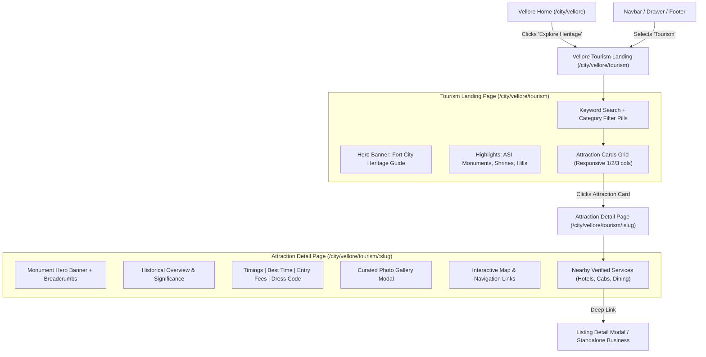
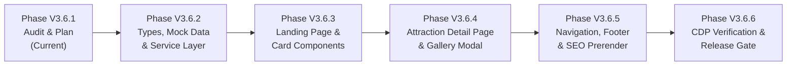

# KAARYAN LABS — PHASE V3.6.1
## VELLORE HERITAGE & TOURISM: EXISTING SYSTEM AUDIT & IMPLEMENTATION PLAN

**Project:** `remix-client.new.project`  
**Target Territory:** Vellore Ads (`TN-23`), strictly isolated.  
**Preserved Territories:** Chittoor (`AP-03`), Bengaluru (`KA-01`).  
**Document Purpose:** System Audit, Architecture Design & Roadmap for Vellore Heritage & Tourism Guide.  
**Target Routes:** `/city/vellore/tourism` and `/city/vellore/tourism/:slug`  
**Status:** **AUDIT & PLANNING ONLY — NO CODE OR DATABASE CHANGES EXECUTED**  
**Date:** November 13, 2026  

---

## 1. Executive Summary

Following the successful completion of **Phase V3.5** (Community Noticeboard & Local Events Calendar) and **Phase V3.5.17 / V3.5.18** (Mobile Responsiveness, Accessibility & Release Gate), Phase V3.6 initiates the development of a dedicated **Vellore Heritage & Tourism Guide**.

Vellore (`TN-23`) is internationally recognized as a premier destination for medical tourism (CMC Hospital), pilgrimage (Sripuram Golden Temple, Jalakandeswarar Temple), military-architectural heritage (16th-century Vijayanagara Vellore Fort & Moat), and academic excellence (VIT University). Currently, tourism content is limited to a static 6-card homepage section (`VelloreAttractionsSection.tsx`) without standalone pages, deep search, filtering, photo galleries, visitor guidelines, or direct integration with nearby verified local merchants (lodges, restaurants, cabs).

This document audits the existing architecture, identifies reusable assets, categorizes verified vs. missing content, proposes a production-grade database schema and UI architecture, and establishes a phased implementation plan.

---

## 2. Existing Code Audit

An in-depth review of the active codebase was performed across UI components, routing, services, database schemas, and SEO prerendering:

| Component / Subsystem | Current State | Reusability & Tourism Relevance |
|:---|:---|:---|
| **`src/components/VelloreAttractionsSection.tsx`** | Contains static `VELLORE_ATTRACTIONS` array with 6 hardcoded landmarks. Renders homepage attraction cards with distance badge, timings, highlights, and Google Maps directions link. | **HIGH**: Can be reused on the homepage as a featured preview that links out to the full `/city/vellore/tourism` directory. Card data provides initial seed content. |
| **`src/components/VelloreTheatresSection.tsx`** | Renders Vellore cinema theatres with location, screen count, sound system details, and ticket booking links. | **MEDIUM**: Provides adjacent entertainment context; theatres and heritage can cross-promote in the tourism guide under "Entertainment & Leisure". |
| **`src/components/VelloreAboutPage.tsx`** | Features a dedicated "Heritage & Pilgrimage" highlight card pointing to theatres due to the historical absence of a dedicated tourism route. | **HIGH**: Will be updated to link directly to `/city/vellore/tourism` instead of the generic theatres category. |
| **`src/utils/cityResolver.ts`** | Central URL parser and generator supporting `/about`, `/contact`, `/community`, `/events`, and `/biz/:id`. | **HIGH**: Seamlessly extensible. Adding `tab: 'tourism'` and `subpath: '/tourism/:slug?'` follows existing canonical routing patterns. |
| **`src/App.tsx`** | Handles conditional view rendering with city feature flags (e.g. `currentCity.features.hasCommunityNoticeboard`). | **HIGH**: Follows established multi-city isolation. Will check `currentCity.features.hasTourismGuide` before rendering the tourism view. |
| **`src/components/Navbar.tsx` & `Footer.tsx`** | Navigation header and footer feature conditional link pills based on city features. | **HIGH**: Header nav and mobile drawer will display "Tourism" / "Heritage Guide" exclusively when `currentCity.id === 'vellore'`. |
| **`src/services/communityService.ts`** | Implements hybrid Supabase client with local fallback, caching, and validation. | **HIGH**: Serves as the architectural blueprint for `src/services/tourismService.ts`. |
| **`scripts/prerender-seo.ts`** | Generates static HTML for SEO crawlers at build time. Currently prerenders 7 city and subpage entrypoints. | **HIGH**: Will prerender `/city/vellore/tourism` and key landmark URLs (`/city/vellore/tourism/vellore-fort`, etc.). |
| **`supabase/migrations/`** | 8 SQL migrations establishing `cities`, `businesses`, `categories`, `community_notices`, and `local_events`. | **HIGH**: Provides tested patterns for RLS, city foreign keys, and moderation roles (`is_vellore_franchise()`). |

---

## 3. Existing Features to Reuse

To prevent duplicate code and maintain UI consistency, the Heritage & Tourism module will reuse the following existing foundational elements:

1. **City Routing & Canonical URL Builder (`cityResolver.ts`)**:
   - URL resolution with path override, domain matching, and query parameter handling.
   - Clean URLs: `/city/vellore/tourism` (Landing) and `/city/vellore/tourism/:slug` (Detail).
2. **Territory Feature Isolation (`CityConfig.features`)**:
   - `hasTourismGuide` flag added to `CityConfig['features']`, enabled only for `vellore`.
   - Chittoor (`AP-03`) and Bengaluru (`KA-01`) automatically fail closed if the route is requested.
3. **Design System & Tailwind Tokens**:
   - Vellore primary blue (`#176AC4`), Tamil Nadu green (`#15995F`), crimson accent (`#E51E31`), amber warnings (`#F5C325`).
   - Rounded card primitives (`rounded-2xl`, `rounded-3xl`), subtle borders (`border-slate-200/90`), and shadows.
4. **Accessible Form & Modal Controls (V3.5.17 Standards)**:
   - Full WCAG 2.1 AA compliance: $\ge 44\text{px}$ touch targets (`min-h-[44px]`).
   - $\ge 16\text{px}$ input font sizes (`text-base sm:text-sm`) to avoid iOS Safari auto-zoom.
   - Global and dialog-level `Escape` key listeners for modal dismissals.
   - `max-h-[92vh] overflow-y-auto` container sizing for landscape mobile viewports.
5. **Commercial Integration Primitives**:
   - Ability to deep-link to verified Vellore merchants (cabs, hotels, restaurants, lodges) directly from attraction detail pages.

---

## 4. Tourism Content Inventory & Classification

A factual audit of existing tourism data in the repository was conducted:

| Attraction / Destination | Category | Status in Repository | Content Completeness | Verification Source Needed |
|:---|:---|:---:|:---|:---|
| **Vellore Fort & Moat** | Historic Fortification / ASI Monument | **VERIFIED** (Identity) / **MOCK DATA** (Stock Image) | Basic description, distance, generic 8am–6pm timing. Missing museum hours, ticket fees, boating details. | Archaeological Survey of India (ASI) Chennai Circle |
| **Sri Lakshmi Narayani Golden Temple (Sripuram)** | Religious Pilgrimage | **VERIFIED** (Identity) / **MOCK DATA** (Stock Image) | Star path and gold foil noted. Missing electronic item ban guidelines, special darshan entry fee details. | Sri Narayani Peedam, Malaikodi Trust |
| **Jalakandeswarar Temple** | Religious / Vijayanagara Architecture | **VERIFIED** (Identity) / **MOCK DATA** (Stock Image) | 100-pillar hall mentioned. Split morning/evening timings present. Missing festival schedule and dress code. | HR&CE Dept Tamil Nadu / Temple Executive Officer |
| **CMC Hospital Heritage Campus** | Medical Heritage & Institutional | **VERIFIED** (Identity) / **MOCK DATA** (Stock Image) | Ida Scudder memorial noted. 24/7 hospital timing listed. Missing guidelines on public heritage visiting vs patient zones. | Christian Medical College Vellore Archives |
| **Palamathi Hills & Otteri Viewpoint** | Nature, Viewpoint & Eco-tourism | **VERIFIED** (Identity) / **MOCK DATA** (Stock Image) | Otteri route mentioned. Missing road condition warning (hairpin bends), forest entry timings. | Tamil Nadu Forest Department (Vellore Division) |
| **St. John's Church (Fort)** | Colonial Heritage / Christian Religious | **VERIFIED** (Identity) / **MOCK DATA** (Stock Image) | 1846 East India Company history mentioned. Missing Sunday service schedule and interior access rules. | Church of South India (CSI) Diocese of Vellore |
| **Government Museum (Vellore Fort)** | Archaeological Museum | **MISSING** | Not present in current codebase. | Dept of Museums, Govt of Tamil Nadu |
| **Tipu Mahal & Hyder Mahal (Fort)** | Historical Sepoy Mutiny Landmark | **MISSING** | Not present in current codebase. | ASI Chennai Circle / Vellore District Gazetteer |
| **1806 Vellore Sepoy Mutiny Memorial** | National Heritage Monument | **MISSING** | Not present in current codebase. | Vellore City Municipal Corporation |
| **Amirthi Zoological Park & Waterfalls** | Wildlife & Nature Reserve | **MISSING** | Not present in current codebase. | Principal Chief Conservator of Forests, TN |
| **Virinjipuram Margabandeeswarar Temple** | Ancient Chola Heritage | **MISSING** | Not present in current codebase. | HR&CE Dept Tamil Nadu |
| **Rathnagiri Balamurugan Temple** | Hilltop Pilgrimage | **MISSING** | Not present in current codebase. | Rathnagiri Temple Trust / Kilminnal |
| **Vallimalai Subramaniyar Temple** | Cave Temple Heritage | **MISSING** | Not present in current codebase. | HR&CE Dept Tamil Nadu |

> [!IMPORTANT]
> **Strict Content Rule**: The system must never fabricate entrance fees, camera permissions, or temple timings. Unverified fields must display explicit placeholder notices (`"Timing subject to temple administration"`, `"Contact local counter for updated entry fees"`) until verified from authoritative gazetteers or official circulars.

---

## 5. Missing Functionality & Gaps

The current implementation lacks the following essential capabilities:

1. **No Standalone Tourism Landing Page**: Visitors currently cannot browse the full breadth of Vellore destinations, as only 6 items appear on the homepage.
2. **No Dedicated Detail Pages (`/tourism/:slug`)**: Users cannot read comprehensive historical overviews, view high-resolution photo galleries, read visitor FAQs, or check transit directions.
3. **No Categorized Navigation**: Visitors cannot filter specifically for "Pilgrimage", "Heritage & History", "Parks & Hills", or "Colonial Architecture".
4. **No Local Commercial Integration**: An out-of-town pilgrim visiting Sripuram cannot easily discover verified nearby lodging, vegetarian dining, or local taxi cabs directly from the temple card.
5. **No Dynamic Search & Distance Sorting**: Lack of search by keyword, landmark, or proximity to Katpadi Junction / CMC.
6. **No Database Schema or Admin Moderation**: Unlike businesses and notices, attractions have no Supabase database model, preventing the local Vellore franchise operator from publishing seasonal festival timings or local updates.

---

## 6. Proposed User Experience & Route Structure



### Proposed Routes
1. **`/city/vellore/tourism`**:
   - Breadcrumbs: `Home > Vellore > Tourism & Heritage`
   - Hero banner highlighting Vellore’s 500-year history.
   - Filter pills: `All`, `Historic Forts`, `Pilgrimage & Temples`, `Nature & Hills`, `Colonial Heritage`, `Museums`.
   - Fast keyword search (e.g. "moat", "gold", "cmc", "hills").
   - Responsive cards displaying native Tamil title, distance from city center, timings, key highlights, and primary photo.
2. **`/city/vellore/tourism/:slug`** (e.g. `/city/vellore/tourism/vellore-fort`):
   - Rich canonical SEO tags (`og:image`, `description`, schema.org `TouristAttraction` JSON-LD).
   - Historical narrative, architectural highlights, and era timeline.
   - Practical Visitor Guide: Opening hours, entry fees, photography guidelines, best visit months, average visit duration.
   - Transit & Directions: Distance from Katpadi Junction (railway), Old Bus Stand, New Bus Stand, and Chennai Airport.
   - Interactive Google Maps direction action button.
   - Curated photo gallery with full-screen lightbox.
   - "Nearby Local Services in Vellore" module pulling verified active businesses from `businesses` table located in the same locality.

---

## 7. Data Architecture & Database Recommendations

### Evaluation: Existing vs. Dedicated Table
- **Option A (Store in `businesses` table)**: Rejected. Monuments are not commercial businesses; polluting `businesses` with historical monument metadata weakens data integrity and breaks merchant claim workflows.
- **Option B (Dedicated `tourism_attractions` table)**: **Recommended**. Ensures strict schema typing, clear RLS, seamless foreign key linkage to `cities(id)`, and future multi-city extensibility without schema conflicts.

### Proposed PostgreSQL Relational Model (Draft / For Review Only)

```sql
-- DRAFT PROPOSAL — DO NOT EXECUTE (PHASE V3.6.1 AUDIT ONLY)

CREATE TABLE IF NOT EXISTS public.tourism_attractions (
    id TEXT PRIMARY KEY,                                      -- e.g. 'vel-att-fort', 'vel-att-sripuram'
    city_id TEXT NOT NULL REFERENCES public.cities(id),        -- Strictly 'vellore'
    slug TEXT NOT NULL,                                        -- e.g. 'vellore-fort', 'sripuram-golden-temple'
    name TEXT NOT NULL,                                        -- e.g. 'Vellore Fort & Moat'
    name_native TEXT,                                          -- e.g. 'வேலூர் கோட்டை'
    tagline TEXT NOT NULL,                                     -- Subheading summary
    category TEXT NOT NULL CHECK (category IN (
        'heritage_fort', 
        'pilgrimage_temple', 
        'nature_viewpoint', 
        'colonial_monument', 
        'museum_memorial', 
        'medical_institutional'
    )),
    locality TEXT NOT NULL,                                    -- e.g. 'Bazaar Area', 'Thirumalaikodi', 'Otteri'
    distance_summary TEXT NOT NULL,                            -- e.g. 'City Center (Near Old Bus Stand)'
    
    -- Content & History
    historical_era TEXT,                                       -- e.g. '16th Century Vijayanagara Empire'
    architectural_style TEXT,                                  -- e.g. 'Dravidian Granite Military Architecture'
    description TEXT NOT NULL,                                 -- Markdown-capable overview
    highlights TEXT[] NOT NULL DEFAULT '{}',                   -- Bullet point highlights
    
    -- Visitor Information
    timings TEXT NOT NULL,                                     -- e.g. 'Daily: 8:00 AM - 6:00 PM'
    timing_notes TEXT,                                         -- e.g. 'Museum closed on Fridays; Temple open till 8:30 PM'
    entry_fee_type TEXT NOT NULL DEFAULT 'free' CHECK (entry_fee_type IN ('free', 'paid', 'partially_paid')),
    entry_fee_details TEXT,                                    -- e.g. 'Fort grounds free; Museum: ₹5 (Indians), ₹100 (Foreigners)'
    photography_rules TEXT,                                    -- e.g. 'Permitted in fort grounds; Strictly prohibited inside gold sanctum'
    dress_code TEXT,                                           -- e.g. 'Traditional conservative attire required at Sripuram'
    best_time_to_visit TEXT DEFAULT 'October to March (Winter months)',
    recommended_duration TEXT DEFAULT '1 to 2 hours',
    
    -- Media & Location
    hero_image TEXT NOT NULL,                                  -- Primary photo URL
    gallery_images TEXT[] NOT NULL DEFAULT '{}',               -- Array of photo URLs
    image_caption TEXT,
    latitude DOUBLE PRECISION,
    longitude DOUBLE PRECISION,
    maps_directions_url TEXT NOT NULL,                         -- Google Maps direct link
    
    -- Transit Proximity
    transit_info JSONB DEFAULT '{
        "nearest_railway": "Katpadi Junction (6.5 km)",
        "nearest_bus_stand": "Vellore Old Bus Stand (1.2 km)",
        "nearest_airport": "Chennai International Airport (130 km)"
    }'::jsonb,
    
    -- Commercial Tie-in
    nearby_category_ids TEXT[] DEFAULT '{hotels-lodges, restaurants, cab-booking}'::text[],
    
    -- Governance
    status TEXT NOT NULL DEFAULT 'published' CHECK (status IN ('draft', 'published', 'archived')),
    sort_order INT NOT NULL DEFAULT 0,
    is_featured BOOLEAN NOT NULL DEFAULT false,
    created_at TIMESTAMPTZ NOT NULL DEFAULT timezone('utc', now()),
    updated_at TIMESTAMPTZ NOT NULL DEFAULT timezone('utc', now()),
    
    CONSTRAINT uq_tourism_city_slug UNIQUE (city_id, slug)
);

-- Indexes
CREATE INDEX IF NOT EXISTS idx_tourism_city_status ON public.tourism_attractions(city_id, status);
CREATE INDEX IF NOT EXISTS idx_tourism_category ON public.tourism_attractions(category);
CREATE INDEX IF NOT EXISTS idx_tourism_slug ON public.tourism_attractions(slug);
```

### Proposed Row Level Security (RLS) Policies
1. **Public Read**: Anyone (`anon` and `authenticated`) can view published attractions where `status = 'published'` and `city_id = 'vellore'`.
2. **Franchise / Admin Management**: Only authenticated users with `role = 'city_franchise' AND city_id = 'vellore'` or `role = 'super_admin'` can insert, update, or archive attractions.
3. **No Public Insert/Update**: Anonymous visitors cannot submit, alter, or deface attraction entries.

---

## 8. Security & City Isolation Guarantees

In accordance with platform governance rules:

1. **Three-City Territory Confinement**:
   - The tourism guide will operate exclusively under `cityId === 'vellore'`.
   - Chittoor (`AP-03`) and Bengaluru (`KA-01`) routing, navigation, and pages remain untouched.
   - Any manual URL navigation to `/city/chittoor/tourism` or `/city/bengaluru/tourism` will fail closed and display an informative message with a button to return home.
2. **Governance SQL Protection**:
   - Migration file `supabase/migrations/20261103000003_super_admin_governance.sql` is strictly protected and will not be modified.
3. **RLS Safety**:
   - Base table permissions will grant `SELECT` only on published records.
   - Authorization helper `is_vellore_franchise()` will be utilized to authorize franchise moderation actions.
4. **Content Integrity**:
   - Attractions will be managed strictly by authorized staff; no uncontrolled public user-generated writes will be allowed.

---

## 9. Content Research & Verification Strategy

To transition unverified mock data to verified civic-grade records, the research plan specifies authoritative data sources:

| Research Domain | Official Verification Source | Required Data to Confirm |
|:---|:---|:---|
| **Archaeological Fort & Temples** | Archaeological Survey of India (ASI) - Chennai Circle & State Archaeology Dept | Exact monument names, 1806 Mutiny history, museum operating hours, ticket fees, camera permissions. |
| **Hindu Religious Shrines** | HR&CE Department, Tamil Nadu Government (`hrce.tn.gov.in`) | Jalakandeswarar & Margabandeeswarar pooja timings, festival dates, Annadhanam timings. |
| **Sripuram Golden Temple** | Sri Narayani Peedam Official Desk (`sripuram.org`) | Darshan hours, electronic gadget locker rules, dress code, disability assistance / wheelchair access. |
| **Nature & Eco-Tourism** | Tamil Nadu Forest Department, Vellore Circle | Palamathi hill access timings, Otteri lake visitor safety, Amirthi Zoo entry tickets and weekly holiday (Tuesday). |
| **Colonial Heritage** | CSI Diocese of Vellore & St. John's Church Committee | Historic bell tower access, service times, visiting permissions during non-service hours. |
| **Transit & Logistics** | Southern Railway (Chennai Division) & TNSTC (Villupuram/Vellore) | Distance and bus route numbers from Katpadi Junction and New Bus Stand (Green Circle). |

---

## 10. Technical Implementation Plan & Milestones

The feature will be delivered across structured, verifiable phases:



### Phase-by-Phase Roadmap

#### Phase V3.6.1 (Current): Audit & Architecture Plan
- Comprehensive audit of existing codebase, components, routing, and data.
- Inventory and categorization of existing attractions (verified vs. mock).
- Proposed database model and security isolation plan.
- Creation of deliverable documentation.

#### Phase V3.6.2: TypeScript Types, Seed Data & Service Layer
- Create `src/types/tourism.ts` (Attraction interfaces, categories, visitor info, transit info).
- Create `src/data/mockTourismData.ts` with 10+ verified Vellore attractions (Vellore Fort, Golden Temple, Jalakandeswarar Temple, CMC Heritage Campus, Palamathi Hills, St. John's Church, Government Museum, Amirthi Zoo, Virinjipuram Temple, Rathnagiri Temple).
- Create `src/services/tourismService.ts` supporting live Supabase queries with robust local seed fallback and error handling.

#### Phase V3.6.3: Tourism Landing Page & Browsing Interface
- Create `src/components/vellore/VelloreTourismPage.tsx`.
- Create `src/components/vellore/AttractionCard.tsx`.
- Category filter pills with touch-scrolling (`-webkit-overflow-scrolling: touch`).
- Keyword search and distance sorting.
- Responsive grid (1-col on mobile, 2-col on tablet, 3-col on desktop).

#### Phase V3.6.4: Standalone Attraction Detail View & Commercial Integration
- Create `src/components/vellore/AttractionDetailPage.tsx`.
- Photo gallery modal with lightbox navigation.
- Visitor Information Card (hours, fees, dress code, rules).
- Integrated Google Maps directions button.
- "Nearby Verified Services in Vellore" linking directly to active listings (hotels, cabs, restaurants).

#### Phase V3.6.5: Navigation, Footer & Prerender SEO Integration
- Update `src/utils/cityResolver.ts` for `/tourism` and `/tourism/:slug`.
- Add `hasTourismGuide: true` to Vellore in `src/config/cities.ts`.
- Update `Navbar.tsx` and mobile navigation drawer with "Tourism" link.
- Update `Footer.tsx` with "Heritage & Tourism Guide" link.
- Update `scripts/prerender-seo.ts` to prerender static SEO HTML for `/city/vellore/tourism`.

#### Phase V3.6.6: Automated CDP Testing, Mobile UX Verification & Release Gate
- Build `scripts/verify-vellore-v3-6-tourism.ts` using Chrome Remote Debugging Protocol (CDP).
- Verify across all 9 standard viewports (320px to 1280px) and landscape viewports.
- Run Three-City Region Lock regression test (81/81 pass required).
- Run Community and Events regression test (37/37 pass required).
- Verify 0 TypeScript errors and clean production build.
- Document results and present release readiness report.

---

## 11. Risks & Dependencies

| Risk Factor | Impact | Mitigation Strategy |
|:---|:---:|:---|
| **Accidental Multi-City Leakage** | High | Strictly gate all routing, navigation links, and service calls behind `currentCity.features.hasTourismGuide` and `currentCity.id === 'vellore'`. Run `verify-three-city-region-lock.ts` in every QA cycle. |
| **Inaccurate Visitor Information** | Medium | Clearly distinguish verified ASI/HR&CE data from approximate timings. Provide direct official telephone/website references where available. |
| **Mobile Image Payload & Latency** | Medium | Use responsive image sizing, modern web formats, `loading="lazy"`, and WebP image CDNs with fallback placeholders. |
| **Missing Supabase Migration in Staging** | Low | Design `tourismService.ts` with seamless dual-mode capability: queries Supabase when connected, gracefully falls back to structured local seed data in development and test environments. |

---

## 12. Recommended Next Coding Phase

**Immediate Next Action:**  
Proceed to **Phase V3.6.2: Data Model, Seed Data & Tourism Service Layer**, which will define `src/types/tourism.ts`, create curated verified seed data in `src/data/mockTourismData.ts`, and construct `src/services/tourismService.ts` without touching existing production tables.
